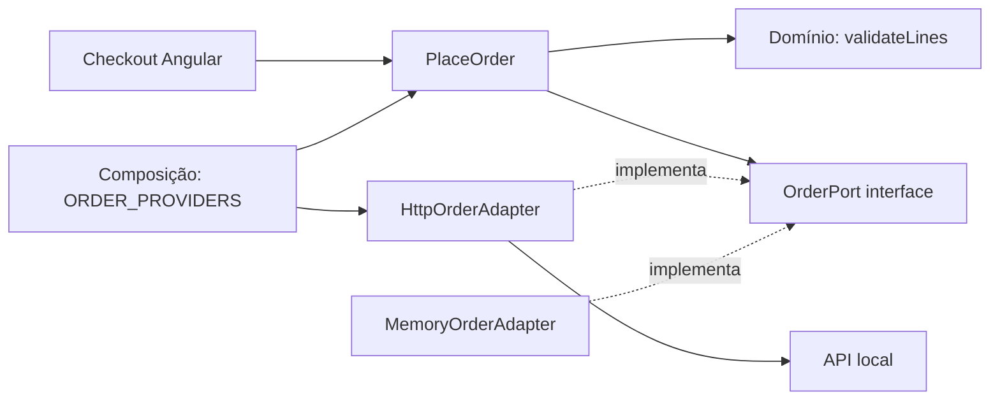
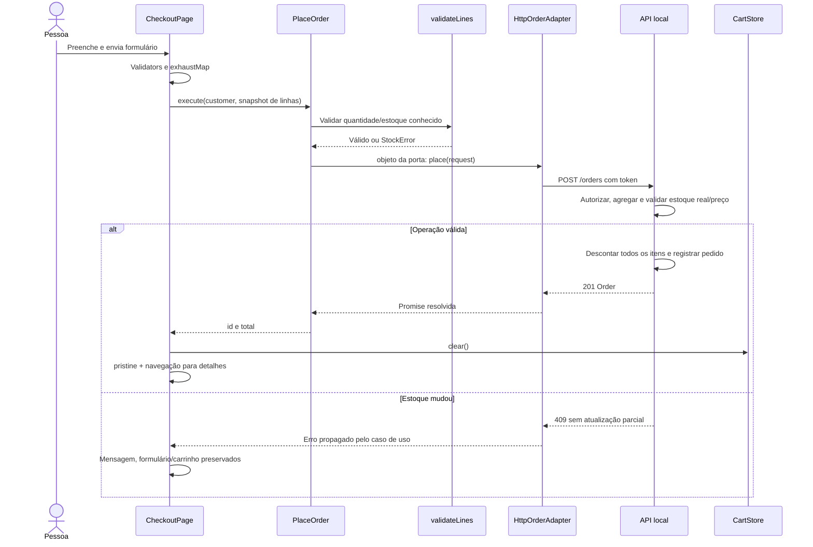

# Arquitetura e conceitos essenciais

## Hexagonal: dependências de código

A seta de dependência indica “importa/conhece”. `PlaceOrder` conhece apenas a interface `OrderPort`; não importa adapter, InjectionToken ou HttpClient. `HttpOrderAdapter` conhece e implementa a porta. `MemoryOrderAdapter` permite testar a operação sem transporte. Os DTOs de domínio também não importam Angular. O contrato TypeScript é estrutural: modelos equivalentes podem satisfazê-lo sem herança.

**A interface é a porta. Ela não executa, recebe em runtime ou encaminha chamadas.** Interfaces são apagadas no JavaScript gerado. Quem executa `place` é o objeto concreto recebido pelo construtor. O `InjectionToken<OrderPort>` existe em runtime para resolver esse objeto na composição Angular; não é a interface em si.

O fluxo de execução, por outro lado, sai da interação e chega à infraestrutura:

O uso de adapters não torna o domínio responsável por HTTP. Fluxo de execução e direção das dependências são conceitos diferentes. O `useFactory` cria o caso de uso com `inject(ORDER_PORT)` e o `useClass` escolhe HttpOrderAdapter. Apenas a composição precisa saber qual adapter usar. A apresentação sabe que há um caso de uso, não os detalhes de transporte.

## Imports standalone e DI

| Situação do projeto                    | Mecanismo                                        | Consequência                                                          |
| -------------------------------------- | ------------------------------------------------ | --------------------------------------------------------------------- |
| `<ui-field>` em checkout               | `imports: [FieldComponent, ReactiveFormsModule]` | Template reconhece componente/diretivas; não cria serviço de carrinho |
| `{{ valor \| brl }}`                   | `imports: [BrlPipe]`                             | Disponibiliza pipe no template                                        |
| `inject(CartStore)`                    | Injector resolve classe root                     | Obtém objeto compartilhado                                            |
| `inject(ORDER_PORT)`                   | Provider useClass                                | Obtém implementação da porta                                          |
| `new PlaceOrder(adapter)` em teste     | Construção TypeScript normal                     | Não precisa de Angular                                                |
| `providers: [CartStore]` em componente | Novo provider no injector filho                  | Pode criar outro carrinho; o cabeçalho não vê suas mudanças           |

Um import TypeScript também é distinto de `imports` nos metadados: ele torna um símbolo acessível no arquivo. DI precisa de token e provider; a classe é token quando fornecida diretamente. Interfaces não servem como token porque não existem em runtime.

## Signals e BehaviorSubject

| Aspecto           | Signals: CartStore                     | BehaviorSubject: FiltersStore                                     |
| ----------------- | -------------------------------------- | ----------------------------------------------------------------- |
| Leitura           | `cart.lines()` síncrona                | Emissão via `filters$`, inclusive valor atual para novo assinante |
| Escrita           | Signal privado, métodos públicos       | Subject privado, `update`, público asObservable                   |
| Derivação         | computed quantity/subtotal/total       | Pipeline com distinctUntilChanged e switchMap                     |
| Renderização      | Template rastreia leituras no OnPush   | Catálogo usa toSignal para consumir resultado RxJS                |
| Cleanup           | computed não exige unsubscribe         | takeUntilDestroyed ou toSignal limpam subscriptions               |
| Uso adequado aqui | Estado de interface e totais imediatos | Sequência temporal de buscas HTTP                                 |

Não há BehaviorSubject contendo uma segunda cópia do carrinho. O Observable de filtros é a única fonte dos critérios. O `toSignal` converte o resultado assíncrono das buscas em um modelo de tela, sem escrever de volta nos filtros; é uma ponte justificada para consumir HTTP no template moderno. Não é duplicação concorrente de fonte de verdade.

`CartStore` atualiza com novo array e novas linhas; `FiltersStore` espalha o objeto anterior; administração troca o pedido com `map`. Não use `push`, alteração de `line.quantity` ou mutação profunda de produtos. O readonly é proteção de tipos e disciplina, não congelamento profundo em runtime.

Stores root sobrevivem à navegação. O formulário do checkout é destruído ao sair. O filtro root continua, mas um reload do navegador recria todos os objetos root e zera sessão/carrinho/filtros. A API continua mantendo pedidos enquanto o processo estiver ativo. Logout/login limpam carrinho para não transferir itens entre perfis.

## Comunicação e ciclo de vida

`CatalogPage` passa produto ao `ProductCard` por input; o filho emite `added`, e o pai coordena `CartStore.add`. Output é um evento. **Emitir output não dispara ngOnChanges**. Esse hook roda quando Angular detecta nova atribuição de input durante a atualização do componente. O teste primeiro clica e confirma que disponibilidade permanece; depois troca o input e confirma novo texto.

| Hook            | Uso real                                                         | Explicação                                                                                |
| --------------- | ---------------------------------------------------------------- | ----------------------------------------------------------------------------------------- |
| ngOnInit        | HistoryPage e AdminPage carregam primeira consulta               | Executa uma vez por instância, após inputs iniciais; não é executado a cada mudança       |
| ngOnChanges     | ProductCard recalcula disponibilidade com novo product           | Recebe SimpleChanges incluindo valor anterior/atual e firstChange                         |
| ngAfterViewInit | ConfirmComponent passa a poder acessar seu dialog por viewChild  | O nó da própria view já existe; effect usa ready para não acessá-lo antes                 |
| DestroyRef      | Checkout resolve confirmação pendente e subscriptions são limpas | Previne recursos e callbacks após destruir a página; takeUntilDestroyed usa o mesmo ciclo |

Na inicialização com inputs, ngOnChanges acontece antes de ngOnInit. Não coloque subscriptions repetidas em ngOnChanges sem estratégia para encerrar as anteriores. O projeto não usa ngOnDestroy porque DestroyRef cobre o recurso que necessita liberação.

No `ui-confirm`, `<dialog>` é **view** criada pelo componente: `viewChild` pode acessá-la. O `
` passado entre tags de `ui-confirm` é **conteúdo projetado** via `ng-content`, criado no contexto do consumidor. Também existe projeção no `ui-button` e `ui-state`. Consultas de conteúdo seriam feitas com contentChild/contentChildren, não viewChild; um ng-content não transforma o conteúdo projetado em view do receptor.

## RxJS a partir das funcionalidades

- `debounceTime(300)`: espera pausa na digitação. `distinctUntilChanged`: evita repetir texto/filtro idêntico.
- `switchMap`: catálogo substitui busca anterior quando filtros mudam. Desinscrever HttpClient cancela a observação/requisição browser anterior; o servidor pode já estar processando.
- `exhaustMap`: checkout e login ignoram novo envio enquanto a operação atual está ativa. `disabled` ajuda a UX, mas o operador também protege o stream. Não é garantia de idempotência no servidor.
- `concatMap`: alterações de status administrativas entram em fila; “separar” antes de “enviar” mantém ordem de HTTP. Não use switchMap para operações que precisam completar na sequência.
- `mergeMap(..., 2)`: reposições de três produtos diferentes são independentes, limitadas a duas simultâneas. A ordem dos resultados não importa; cada resultado tem ID.
- `catchError`: dentro do fluxo interno evita matar permanentemente o stream após um erro. No mergeMap, uma falha não elimina o resultado dos outros produtos.
- `finalize`: encerra busy/loading mesmo em erro ou desinscrição. No catálogo o loading visível vem do modelo emitido por startWith, evitando depender do timing de uma requisição cancelada; finalize é usado em checkout, login, administração e renovação.
- `shareReplay`: renovação única compartilha resultado entre requisições que receberam 401 simultaneamente. `finalize` está antes de shareReplay para limpar a referência ao terminar o transporte único.

## Guards e HTTP

| Guard            | Arquivo/uso                          | Retorno                                   |
| ---------------- | ------------------------------------ | ----------------------------------------- |
| CanActivate      | authenticatedGuard no pai `/pedidos` | true ou UrlTree `/login` com retorno      |
| CanActivateChild | protectedChildrenGuard               | Reavalia sessão em navegação entre filhos |
| CanMatch         | adminMatchGuard em `/admin`          | true ou UrlTree `/sem-permissao`          |
| CanDeactivate    | unsavedGuard no checkout             | boolean ou Promise do modal               |

`CanMatch` retornando **false** não significa necessariamente bloquear toda navegação: o router pode tentar outra rota com o mesmo path. No projeto retornamos UrlTree para intenção de redirecionamento inequívoca. `RedirectCommand` também pode expressar redirecionamento com opções. Evite `navigate()` como efeito colateral seguido de false quando pode retornar árvore/comando.

401 significa autenticação ausente, expirada ou inválida; 403 significa usuário autenticado sem a permissão necessária. O interceptor não desloga em 403. Não renova login/refresh nem URLs externas; a repetição da requisição acontece pelo `next`, sem reentrar indefinidamente no mesmo interceptor. Erro 401 no refresh encerra a sessão; 503 no refresh preserva sessão para possível recuperação.

A ordem configurada é registro externo → Authorization → refresh. Um 401 recuperado não aparece como erro terminal do pedido no logger. O logger armazena status e URL sem token/corpo, sem emitir toast. A tela comunica a falha no contexto da interação. Requisição de refresh e requisição de negócio podem ter registros distintos caso ambas falhem; isso não duplica notificações visuais.

A API verifica tokens, perfil nas rotas admin e proprietário nos detalhes. Guard melhora a navegação; qualquer pessoa pode chamar uma API diretamente, por isso a autorização deve estar no servidor.

## Clean Code e SOLID proporcionais

- SRP: `validateLines` só valida linhas; `PlaceOrder` coordena; adapter traduz para HTTP; componente controla interação e feedback.
- OCP: é possível acrescentar adapter persistente sem editar PlaceOrder, respeitando OrderPort. Não significa que todo sistema nunca precise ser modificado.
- LSP: HttpOrderAdapter e MemoryOrderAdapter entregam Promise de pedido ou rejeitam falha, substituíveis para o caso de uso. Adapter de memória é um double, não uma reprodução de toda a API.
- ISP: OrderPort tem só `place`; consultas estão em OrdersQueryService. O checkout não depende de CRUD administrativo genérico.
- DIP: aplicação depende da abstração e a infraestrutura implementa a abstração. Composition root define a implementação; Angular não entra no núcleo.

Nomes de operação explícitos, DTOs tipados, validação curta e recuperação local de erro evitam camadas genéricas desnecessárias. Queries triviais usam serviço HTTP direto. Não se criam porta, factory e entidade elaborada para cada filtro.

## Testes HTTP

Configure `provideHttpClient()` **antes** de `provideHttpClientTesting()`. O segundo substitui o backend. Assine o Observable ou chame o método Promise primeiro: sem isso não há requisição pendente. Use `expectOne` para URL/parâmetros, confira `.request.method` e `.body`, faça `flush` e então confira o resultado. Em erro, flush com `{ status: 409, statusText: 'Conflict' }`. `verify` no afterEach detecta requisições inesperadas.

`catalog.service.spec.ts` verifica GET completo e erro 503. `http-order.adapter.spec.ts` verifica POST, corpo, resolução Promise e 409. `interceptors.spec.ts` verifica ausência de token externo, dois 401 com um refresh, repetição, 403 e loops. Não use HTTP real nos unitários; teste transporte real na API e E2E.

## Performance e acessibilidade

Componentes usam OnPush e `@for (...; track id)`; rotas são lazy. A busca limita chamadas, catálogo pagina no servidor e consultas convertidas por toSignal são encerradas com a view. Os indicadores são computed, sem duplicar contadores manuais.

Controles nativos têm labels, botão tem tipo explícito, mensagens têm status/alert, ícones decorativos estão ocultos do leitor de tela, foco tem contraste, navegação tem link para pular ao conteúdo. O modal nativo showModal fornece bloqueio e navegação de foco; autofocus prioriza a ação de continuar editando; fechar devolve foco ao elemento anterior. E2E verifica foco e Escape. O layout adapta colunas e cabeçalho em telas pequenas. Isso não substitui auditoria humana completa com leitores de tela.
