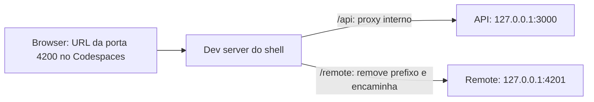
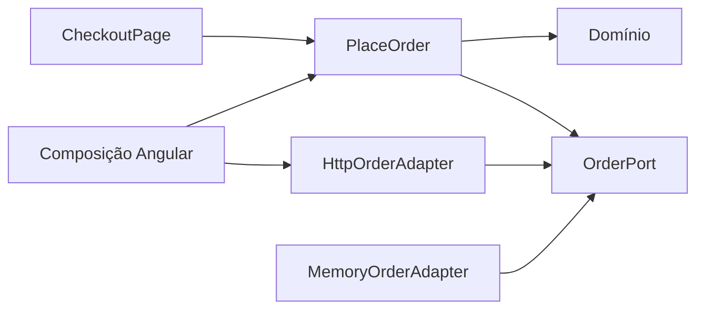
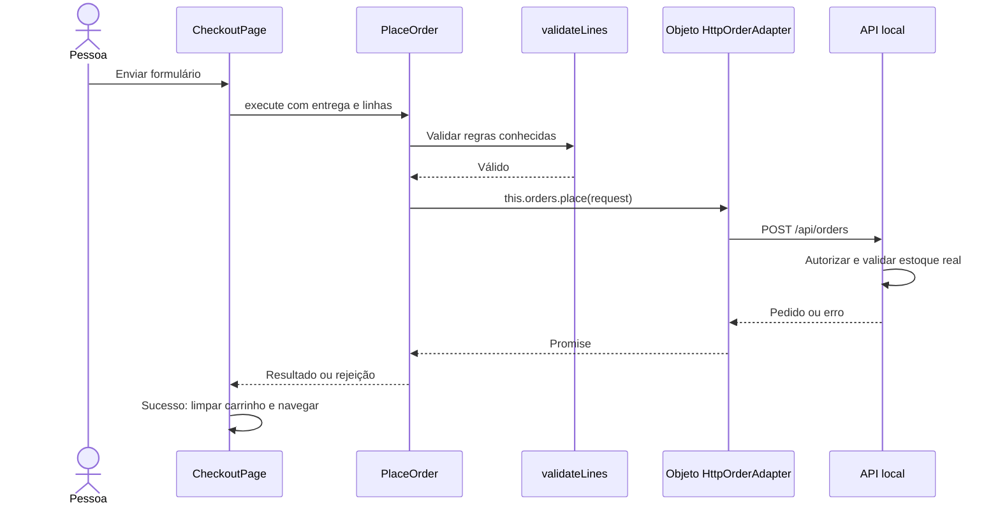
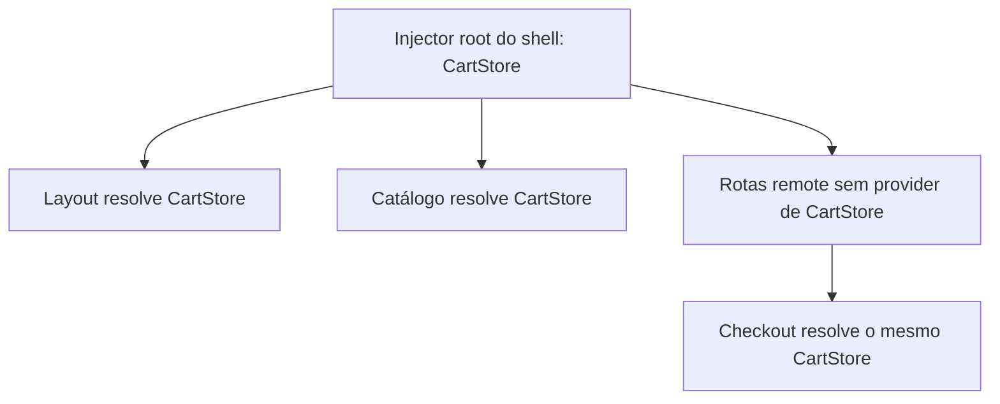
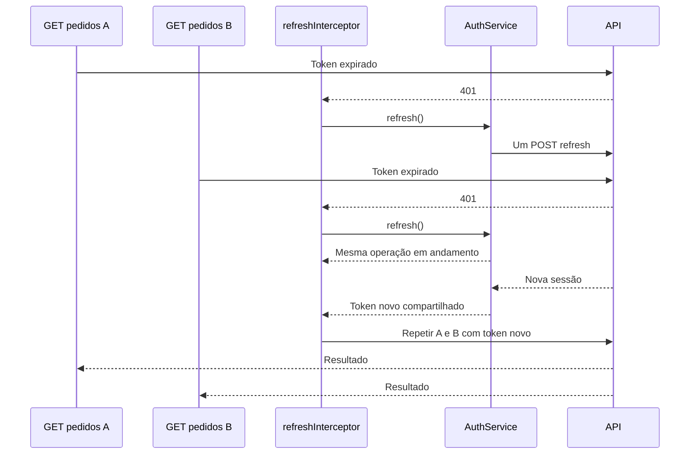

# Guia completo de Angular: conceitos e fluxos do Portal Lab

Este guia usa o portal de pedidos do workspace para explicar os assuntos do pedido original e preparar uma entrevista de nível júnior avançado a pleno inicial. A proposta é que você consiga definir o conceito, explicar o problema que ele resolve, localizar sua implementação e acompanhar os dados circulando.

**Como ler:** acompanhe uma seção com o sistema aberto e o arquivo correspondente ao lado. Os trechos de código são recortes da implementação, com imports ou detalhes omitidos quando não são necessários à explicação. Quando uma alternativa não está implementada, isso é indicado. As explicações ficam neste documento; não foram adicionados comentários didáticos ao código.

## Índice

1. [O portal e sua execução](#1-o-portal-e-sua-execução)
2. [Versões, standalone e Angular moderno](#2-versões-standalone-e-angular-moderno)
3. [Native Federation e integração entre aplicações](#3-native-federation-e-integração-entre-aplicações)
4. [Arquitetura hexagonal: domínio, casos de uso, portas e adapters](#4-arquitetura-hexagonal-domínio-casos-de-uso-portas-e-adapters)
5. [TypeScript aplicado](#5-typescript-aplicado)
6. [Imports standalone, injeção de dependências e providers](#6-imports-standalone-injeção-de-dependências-e-providers)
7. [Ciclo de vida e projeção de conteúdo](#7-ciclo-de-vida-e-projeção-de-conteúdo)
8. [Comunicação entre componentes e imutabilidade](#8-comunicação-entre-componentes-e-imutabilidade)
9. [Signals, computed, effect e BehaviorSubject](#9-signals-computed-effect-e-behaviorsubject)
10. [RxJS: cada operador no cenário correto](#10-rxjs-cada-operador-no-cenário-correto)
11. [Formulários reativos e ControlValueAccessor](#11-formulários-reativos-e-controlvalueaccessor)
12. [HTTP, interceptors, sessão e códigos de erro](#12-http-interceptors-sessão-e-códigos-de-erro)
13. [Router, lazy loading e tipos de guards](#13-router-lazy-loading-e-tipos-de-guards)
14. [Componentes compartilhados, pipe e diretiva](#14-componentes-compartilhados-pipe-e-diretiva)
15. [API local, estoque e segurança](#15-api-local-estoque-e-segurança)
16. [Clean Code e SOLID](#16-clean-code-e-solid)
17. [Performance, acessibilidade e estados de tela](#17-performance-acessibilidade-e-estados-de-tela)
18. [Todos os fluxos funcionais, passo a passo](#18-todos-os-fluxos-funcionais-passo-a-passo)
19. [Testes de comportamento e HttpTestingController](#19-testes-de-comportamento-e-httptestingcontroller)
20. [Mapa dos requisitos, exercícios e entrevista](#20-mapa-dos-requisitos-exercícios-e-entrevista)

## 1. O portal e sua execução

### O que existe no sistema

Um **workspace** é a pasta que reúne projetos e configurações de desenvolvimento. Ele contém duas aplicações Angular, bibliotecas locais e uma API separada. Uma aplicação é executável; uma biblioteca fornece código usado pelas aplicações.

| Parte            | Responsabilidade                                                            | Onde começa                                                           |
| ---------------- | --------------------------------------------------------------------------- | --------------------------------------------------------------------- |
| shell            | Bootstrap, login, layout, navegação, catálogo e administração               | [main.ts do shell](../projects/shell/src/main.ts)                     |
| pedidos-remote   | Checkout, histórico e detalhes, expostos como rotas                         | [order.routes.ts](../projects/pedidos-remote/src/app/order.routes.ts) |
| portal-contracts | DTOs, token API_URL, sessão e contrato público do carrinho                  | [public-api.ts](../projects/portal-contracts/src/public-api.ts)       |
| portal-ui        | Controles visuais reutilizáveis, pipe, diretiva e estilo                    | [public-api.ts](../projects/portal-ui/src/public-api.ts)              |
| API local        | Dados fictícios, autenticação demonstrativa, pedidos, estoque e autorização | [server.mjs](../api/server.mjs)                                       |

A interface fala português. Os identificadores de classes e contratos usam inglês, como `CartStore`, `PlaceOrder` e `OrderPort`; o importante é manter nomes consistentes e relacionados à responsabilidade.

### Como executar e o que o Codespaces muda

Com Node 24 e dependências instaladas:

```bash
npm ci
npm start
```

`npm ci` instala as versões registradas no lockfile. `npm start` inicia API na porta 3000, remote na 4201 e shell na 4200. Espere os dois builds terminarem antes de abrir a página.

No Codespaces, abra a **porta 4200 pela aba Ports**. O `localhost` do navegador pode apontar para seu computador, não para o container. Por isso usamos caminhos relativos e [proxy.conf.json](../projects/shell/proxy.conf.json):



`API_URL` vale `/api`. O manifesto aponta para `/remote/remoteEntry.json`. O browser acessa tudo pela origem do shell; apenas 4200 precisa ser encaminhada e pode permanecer privada. O proxy é uma função do servidor de desenvolvimento: uma hospedagem de produção teria de fornecer um reverse proxy equivalente. Alterações de proxy exigem reiniciar `npm start`. Veja [Angular CLI: proxy](https://angular.dev/tools/cli/serve) e [GitHub: portas no Codespaces](https://docs.github.com/en/codespaces/developing-in-a-codespace/forwarding-ports-in-your-codespace).

**Na entrevista:** “Organizei duas aplicações no mesmo workspace e uma API separada. No desenvolvimento remoto, o browser usa a origem do shell, que encaminha chamadas internas para API e remote.”

## 2. Versões, standalone e Angular moderno

### O que significam as versões

Uma versão como `21.2.25` tem major, minor e patch. Atualizações de major podem exigir migração; minor e patch seguem a política de compatibilidade do projeto. Não basta atualizar apenas o número do Angular: Node, TypeScript, CLI, builder, RxJS e plugin de federação também precisam ser compatíveis.

Este projeto usa as seguintes versões fixadas em [package.json](../package.json) e [package-lock.json](../package-lock.json):

| Ferramenta                | Versão usada                    | Papel                                         |
| ------------------------- | ------------------------------- | --------------------------------------------- |
| Angular framework         | 21.2.25                         | Componentes, DI, forms, router e HTTP         |
| Angular CLI e builders    | 21.2.26                         | Geração, desenvolvimento e compilação         |
| Native Federation Angular | 21.2.6                          | Integração runtime de shell e remote          |
| TypeScript                | 5.9.3                           | Tipagem e compilação                          |
| RxJS                      | 7.8.2                           | Composição de eventos e operações assíncronas |
| Node                      | Linha 24; verificado em 24.21.0 | Execução da API e ferramentas                 |

A [matriz oficial do Angular](https://angular.dev/reference/versions) aceita Node 24, TypeScript >=5.9 e <6 e RxJS 7.8 para Angular 21.2. O [adapter Native Federation v3](https://native-federation.com/docs/v3/angular-adapter/getting-started/) usa a linha 21.x para Angular 21.x. CLI/build e framework têm patches diferentes, mas permanecem na linha 21.2; os builds e a integração foram verificados. Isso não significa que 21 seja a versão mais recente disponível.

### O que é um componente standalone

Um componente standalone define diretamente as dependências de seu template. No Angular usado aqui, standalone é o padrão; não precisamos escrever `standalone: true` em cada componente.

Exemplo do card:

```typescript
@Component({
  selector: 'app-product-card',
  imports: [BrlPipe, ButtonComponent],
  changeDetection: ChangeDetectionStrategy.OnPush,
  template: `...`,
})
export class ProductCard {}
```

`BrlPipe` permite usar `| brl`; `ButtonComponent` permite `<ui-button>`. Esses imports são sobre o template, não sobre criar serviços.

### Como isso se compara a NgModules

| Aplicação com NgModules                                             | Aplicação deste portal                                 |
| ------------------------------------------------------------------- | ------------------------------------------------------ |
| AppModule organiza bootstrap e providers                            | bootstrapApplication usa appConfig                     |
| declarations registra componentes não standalone, pipes e diretivas | Cada componente standalone importa o necessário        |
| imports/exports de módulos fornecem contexto ao template            | imports do componente fornece contexto local           |
| HttpClientModule/RouterModule são comuns na composição              | provideHttpClient/provideRouter configuram a aplicação |
| É comum encontrar guards/interceptors em classes                    | Usamos funções com inject                              |
| É comum encontrar *ngIf/*ngFor                                      | Usamos @if/@for                                        |

Standalone pode importar um NgModule, como `ReactiveFormsModule`. Não há contradição: usamos componentes standalone, mas as diretivas do formulário ainda podem ser disponibilizadas por um módulo existente.

O portal não instala `zone.js`; usa o funcionamento zoneless da linha Angular 21. Signals, eventos e APIs Angular participam da atualização da interface. Isso não elimina o ciclo de vida, o router ou a necessidade de cuidar das subscriptions. NgModules e aplicações com Zone.js continuam relevantes ao trabalhar em projetos de outras versões.

**Na entrevista:** “Escolhi uma linha estável compatível com o adapter de federação, fixei versões e validei o conjunto. Standalone simplifica a composição de templates, enquanto DI continua uma responsabilidade separada.”

## 3. Native Federation e integração entre aplicações

### O que é e para que serve

**Native Federation** permite carregar partes expostas por outra aplicação em runtime e compartilhar dependências entre elas, usando módulos JavaScript e import maps. Um import map relaciona um nome de módulo à URL do arquivo que o browser deve carregar.

É usado em arquiteturas de **microfrontends**, nas quais partes do frontend podem ter builds e ciclos de entrega separados. Não é uma regra de negócio e não substitui uma API. Também não é necessário para toda aplicação: um único frontend com rotas lazy costuma ser mais simples quando não há necessidade de separar aplicações.

Aqui usamos federation porque o objetivo inclui estudar shell e remote. Ter duas aplicações no workspace demonstra a divisão e a carga runtime; não significa que implementamos toda a governança de equipes ou uma implantação independente de produção.

### Host, shell, remote, exposes e manifesto

O **host** é quem consome; o shell é nosso host e também fornece o layout. O **remote** fornece o código exposto. `exposes` define sua API pública de módulos.

Em [federation.config.js do remote](../projects/pedidos-remote/federation.config.js):

```javascript
name: 'pedidos',
exposes: {
  './Routes': './projects/pedidos-remote/src/app/order.routes.ts',
},
```

O nome da aplicação no workspace é `pedidos-remote`, mas o nome público da federação é `pedidos`. `./Routes` é a chave pública; não é uma URL de navegação do usuário. O arquivo exporta `ORDER_ROUTES`, tipado como `Routes` do Angular.

Em [federation.manifest.json](../projects/shell/public/federation.manifest.json):

```json
{
  "pedidos": "/remote/remoteEntry.json"
}
```

O **remoteEntry.json** é gerado pelo build de federation e descreve módulos expostos e dependências compartilhadas. O manifesto escrito por nós informa onde encontrá-lo. Não são o mesmo arquivo.

### Por que main.ts e bootstrap.ts são separados

O shell faz:

```typescript
initFederation('/federation.manifest.json')
  .catch((error) => console.error('Federação indisponível', error))
  .then(() => import('./bootstrap'));
```

A inicialização prepara a federação antes de importar o bootstrap Angular. Importar Angular cedo demais pode avaliar módulos antes de seus nomes compartilhados estarem resolvidos. [bootstrap.ts](../projects/shell/src/bootstrap.ts) chama `bootstrapApplication(App, appConfig)` depois dessa etapa.

A configuração de build usa `@angular-architects/native-federation:build` e delega a compilação Angular ao target `esbuild`, como pode ser visto em [angular.json](../angular.json). Nos testes unitários apontamos diretamente para `esbuild:development`, porque o builder de testes precisa do builder Angular compatível.

### Como o shell carrega as rotas

Em [app.routes.ts](../projects/shell/src/app/app.routes.ts), a rota `pedidos` usa:

```typescript
loadChildren: () =>
  loadRemoteModule('pedidos', './Routes')
    .then((m) => m.ORDER_ROUTES)
    .catch(() =>
      import('./shared/fallback-page').then((m) => [
        { path: '**', component: m.FallbackPage },
      ]),
    ),
```

O shell importa o módulo público pelo nome federado. O Angular recebe suas rotas e monta `/pedidos/checkout`, `/pedidos/historico` e `/pedidos/:id`. Os componentes dessas rotas também são carregados por imports lazy.

Lazy loading e federation se complementam: lazy define quando carregar; federation permite obter o código de outra aplicação. O remoteEntry pode ser consultado na inicialização mesmo que a tela de checkout só seja carregada depois.

### Dependências compartilhadas e singleton

As duas aplicações configuram:

```javascript
shared: {
  ...shareAll({ singleton: true, strictVersion: true, requiredVersion: 'auto' }),
},
sharedMappings: ['portal-contracts', 'portal-ui'],
```

`shareAll` usa dependências do package.json. `skip` exclui pacotes do servidor, runtime Node e entry points não utilizados. Compartilhar pacotes não significa expor indiscriminadamente serviços internos de todas as features.

| Opção                 | O que faz                                                   | Implicação aqui                                                   |
| --------------------- | ----------------------------------------------------------- | ----------------------------------------------------------------- |
| singleton             | Usa uma identidade compartilhada para o módulo/pacote       | Evita duas identidades de CartStore e tokens entre shell e remote |
| requiredVersion: auto | Obtém o requisito de versão do package.json                 | Versões npm fixadas tornam os requisitos explícitos               |
| strictVersion         | Exige respeitar os requisitos de versão no compartilhamento | Atualizações incompatíveis não devem ser aceitas silenciosamente  |
| sharedMappings        | Compartilha aliases locais do tsconfig                      | portal-contracts e portal-ui vêm de uma identidade comum          |

**Singleton de módulo não garante sozinho singleton de serviço.** Mesmo usando a mesma classe, `providers: [CartStore]` em um componente pode criar outro objeto no injector filho. Nós combinamos classe compartilhada com provider root e não redeclaramos os stores nas rotas remote.

Os aliases locais não são pacotes npm publicados com versão própria. Seus artefatos são gerados como singleton, mas sem a validação semver dos pacotes npm. A compatibilidade dos contratos locais depende do alinhamento do workspace e dos testes. Uma evolução independente exigiria contratos versionados e política de compatibilidade. Veja [sharing oficial](https://native-federation.com/docs/v3/core/sharing/).

### O que compartilhamos e o que permanece local

`portal-contracts` expõe CartStore, SessionStore, API_URL e modelos de integração. Checkout usa o carrinho público; não acessa estado interno de filtros do shell. O shell não acessa o FormGroup interno do checkout. Pedidos persistidos são consultados na API, não mantidos em um segundo store global de frontend.

O contrato tem um custo: mudar nome de export, DTO ou método do carrinho pode afetar as duas aplicações. É preciso revisar a integração, não apenas compilar cada aplicação isoladamente.

### Fallback e comprovação prática

Se a importação das rotas remote falhar, mostramos `FallbackPage`: pedidos indisponíveis, carrinho preservado e opção de recarregar. Essa captura não é uma solução genérica para toda falha de chunk depois de as rotas já estarem carregadas.

Abra o checkout e compare o UUID em “Diagnóstico de integração” com o do rodapé. O [E2E](../e2e/portal.spec.ts) também compara esses identificadores e confirma que finalizar no remote zera o contador no shell. O UUID é uma ferramenta didática de observação, não um identificador de negócio.

**Na entrevista:** “O remote expõe rotas e o shell as carrega por Native Federation. Compartilhamos contratos e o carrinho com identidade comum, e o provider root garante a mesma instância. Temos fallback para falha de carregamento inicial, com limites documentados.”

## 4. Arquitetura hexagonal: domínio, casos de uso, portas e adapters

### O que é e para que serve

Arquitetura hexagonal organiza o negócio para que ele não dependa diretamente da forma de entrada ou saída: Angular, HTTP, banco de dados ou detalhes de UI. A lógica central pode ser acionada por interfaces diferentes e testada com implementações alternativas.

O nome “hexagonal” não exige seis camadas ou seis lados no código. O foco são fronteiras e direção das dependências. Aplicamos o exemplo completo à **finalização de pedidos**, que tem coordenação e regras; consultas triviais continuam usando serviços HTTP simples.

### Responsabilidades no checkout

| Parte              | O que faz                                    | Arquivo                                                                                                                                                                                                                                |
| ------------------ | -------------------------------------------- | -------------------------------------------------------------------------------------------------------------------------------------------------------------------------------------------------------------------------------------- |
| presentation       | Coleta entrega, exibe erros e reage ao envio | [checkout-page.ts](../projects/pedidos-remote/src/app/features/orders/presentation/checkout-page.ts)                                                                                                                                   |
| application        | Coordena a finalização                       | [place-order.ts](../projects/pedidos-remote/src/app/features/orders/application/place-order.ts)                                                                                                                                        |
| domain             | Representa os tipos e valida linhas          | [order.ts](../projects/pedidos-remote/src/app/features/orders/domain/order.ts), [order-rules.ts](../projects/pedidos-remote/src/app/features/orders/domain/order-rules.ts)                                                             |
| application/ports  | Define o que o caso de uso precisa da saída  | [order.port.ts](../projects/pedidos-remote/src/app/features/orders/application/ports/order.port.ts)                                                                                                                                    |
| infrastructure     | Implementa a saída HTTP ou em memória        | [http-order.adapter.ts](../projects/pedidos-remote/src/app/features/orders/infrastructure/http-order.adapter.ts), [memory-order.adapter.ts](../projects/pedidos-remote/src/app/features/orders/infrastructure/memory-order.adapter.ts) |
| composição Angular | Escolhe implementação e constrói caso de uso | ORDER_PROVIDERS no adapter HTTP, aplicado em [order.routes.ts](../projects/pedidos-remote/src/app/order.routes.ts)                                                                                                                     |

O domínio do exemplo usa interfaces e funções puras. Não criamos classes de entidade complexas sem necessidade. `application` e `domain` não importam Angular, HttpClient ou RxJS; `npm run check:architecture` verifica essa fronteira básica.

### A porta é uma interface

```typescript
export interface OrderPort {
  place(request: OrderRequest): Promise<PlacedOrder>;
}
```

A porta declara uma operação: “preciso de algo que finalize um pedido e devolva ID e total”. **A interface não executa nem encaminha chamadas.** Ela é apagada quando TypeScript vira JavaScript.

O objeto concreto que implementa a interface executa o método. O caso de uso tem uma referência a esse objeto:

```typescript
export class PlaceOrder {
  constructor(private readonly orders: OrderPort) {}

  async execute(customer: Buyer, lines: readonly RequestedLine[]): Promise<PlacedOrder> {
    validateLines(lines);
    if (customer.name.trim().length < 3 || !customer.acceptTerms)
      throw new Error('Preencha os dados e aceite os termos.');
    return this.orders.place({
      customer: { ...customer },
      lines: lines.map(({ productId, quantity }) => ({ productId, quantity })),
    });
  }
}
```

`this.orders.place(...)` chama o método do objeto fornecido no construtor. Não “chama uma interface”. O payload de saída não inclui estoque conhecido pelo browser nem preço do cliente.

### Adapter HTTP e adapter em memória

O adapter HTTP converte a necessidade do negócio em transporte:

```typescript
place(request: OrderRequest): Promise<PlacedOrder> {
  return firstValueFrom(this.http.post<PlacedOrder>(`${this.api}/orders`, request));
}
```

`HttpClient` entrega Observable; `firstValueFrom` transforma sua primeira resposta em Promise. Assim a aplicação não precisa importar RxJS. O adapter em memória implementa o mesmo método, recebe estoque/preços em Maps e registra pedidos para testes.

É possível testar diretamente:

```typescript
const stock = new Map([['1', 2]]);
const prices = new Map([['1', 1000]]);
const adapter = new MemoryOrderAdapter(stock, prices);
const useCase = new PlaceOrder(adapter);
```

Esse adapter é um double de teste, não uma reprodução completa de todos os endpoints da API. O teste continua precisando verificar a API real separadamente.

### InjectionToken liga porta a adapter

```typescript
export const ORDER_PORT = new InjectionToken<OrderPort>('ORDER_PORT');

export const ORDER_PROVIDERS = [
  { provide: ORDER_PORT, useClass: HttpOrderAdapter },
  { provide: PlaceOrder, useFactory: () => new PlaceOrder(inject(ORDER_PORT)) },
];
```

O token é um objeto que existe em runtime. O provider escolhe o adapter. A factory cria o caso de uso com esse objeto. O núcleo não conhece o token; ele continua aceitando um OrderPort no construtor.

### Direção de dependências versus fluxo de execução

Dependência significa “este arquivo conhece/importa esse contrato”:



Execução significa “quem chama quem na operação”:



A execução chega à infraestrutura, mas a aplicação só depende da porta. Essa é a inversão que permite substituir o adapter.

**Alternativa e custo:** uma feature sem regras poderia usar serviço direto. Aqui a separação custa mais arquivos, mas facilita testes e explicação das responsabilidades. Não aplicamos um repositório genérico para cada operação trivial.

**Na entrevista:** “O checkout chama um caso de uso puro, que valida o domínio e depende de uma porta. A composição Angular injeta o adapter HTTP. Interfaces descrevem contratos; o objeto concreto executa os métodos.”

## 5. TypeScript aplicado

### O que é e por que usamos strict

TypeScript adiciona tipos ao JavaScript para detectar inconsistências durante o desenvolvimento. Ele ajuda a documentar contratos, oferecer autocomplete e impedir operações incompatíveis. A maior parte das informações de tipo desaparece na compilação; o browser executa JavaScript.

Em [tsconfig.json](../tsconfig.json), `strict` ativa verificações rigorosas, incluindo nullability. `strictTemplates` verifica expressões e bindings dos templates. Isso ajuda a descobrir que uma tela passou o tipo errado para um input ou tentou acessar uma sessão que pode ser null.

```typescript
export interface User {
  id: string;
  name: string;
  role: 'customer' | 'admin';
}
```

A união literal limita o perfil aos dois valores conhecidos no código tipado. Esse modelo está em [models.ts](../projects/portal-contracts/src/lib/models.ts).

### Conceitos que aparecem no portal

| Conceito           | Exemplo real                               | Explicação                                                   |
| ------------------ | ------------------------------------------ | ------------------------------------------------------------ |
| Interface          | OrderPort, Product, User                   | Descreve estrutura; não cria objeto                          |
| Tipagem estrutural | HttpOrderAdapter implements OrderPort      | Um objeto com métodos compatíveis pode satisfazer o contrato |
| Generic            | InjectionToken<OrderPort>, signal<Order[]> | Mantém relação entre operação e tipo de valor                |
| União              | Session ou null; role customer ou admin    | Representa alternativas válidas                              |
| Optional chaining  | session()?.user.role                       | Acesso seguro quando pode não haver sessão                   |
| Nullish coalescing | current?.quantity ?? 0                     | Usa valor padrão para null/undefined, preservando zero       |
| readonly           | readonly CartLine[]                        | Impede certas escritas pelo sistema de tipos                 |
| Partial            | Partial<CatalogFilters>                    | Permite atualizar apenas parte de um objeto                  |
| unknown            | body na ação administrativa                | Não presume estrutura para um valor apenas repassado         |
| Narrowing          | error instanceof HttpErrorResponse         | Verifica em runtime e permite tratar erro HTTP específico    |
| Promise            | Promise<PlacedOrder>                       | Representa um resultado futuro ou rejeição                   |
| Map/Set            | estoque do adapter e IDs da regra          | Map associa chave/valor; Set identifica duplicatas           |

`Parameters<CartStore['setQuantity']>[0]` obtém o tipo do primeiro parâmetro do método. Isso mantém o tipo do produto ligado à assinatura do store, embora importar `Product` diretamente fosse uma alternativa mais explícita para quem está começando.

### Três confusões a evitar

`http.get<Order>()` descreve o resultado esperado para o compilador; não valida a forma de qualquer JSON recebido. Por isso a API precisa validar entradas e sistemas reais podem validar contratos também na fronteira de leitura.

`as HTMLInputElement` é uma afirmação de tipo, não uma conversão nem um teste. No checkout, o evento foi ligado a um input nativo, sustentando essa afirmação. Para um evento de origem incerta, seria melhor conferir o elemento antes de acessá-lo.

`readonly` não congela profundamente objetos em runtime. Mesmo com estado somente leitura, precisamos seguir atualizações imutáveis; um cast pode contornar a proteção de tipos.

**Na entrevista:** “Uso strict para tornar null e contratos explícitos. Interfaces ajudam a desacoplar, mas não existem em runtime; entrada externa ainda precisa de validação real.”

## 6. Imports standalone, injeção de dependências e providers

### São três coisas diferentes

Um **import TypeScript** disponibiliza um símbolo ao arquivo. O **imports do componente standalone** informa o que seu template pode usar. A **injeção de dependências**, ou DI, fornece objetos ao componente ou serviço por meio de um injector.

```typescript
import { FieldComponent } from 'portal-ui';
```

Esse import permite escrever `FieldComponent` no arquivo. Para usar `<ui-field>` no template, ele também precisa estar no contexto do componente:

```typescript
imports: [ReactiveFormsModule, FieldComponent],
```

Para obter o carrinho, fazemos outra operação:

```typescript
readonly cart = inject(CartStore);
```

Não colocamos CartStore nos imports do template. O injector procura um provider para o token CartStore e resolve o objeto correspondente.

### O que é token, provider e injector

**Token** identifica a dependência. Pode ser uma classe, como CartStore, ou um InjectionToken, como API_URL. **Provider** define como obter seu valor. **Injector** mantém a configuração e resolve dependências dentro de seu escopo.

| Forma de provider | Exemplo do sistema                   | O que acontece                                                  |
| ----------------- | ------------------------------------ | --------------------------------------------------------------- |
| providedIn: root  | CartStore e SessionStore             | Serviço disponível no injector root da aplicação que os consome |
| useValue          | API_URL recebe `/api`                | Fornece uma configuração pronta                                 |
| useClass          | ORDER_PORT usa HttpOrderAdapter      | Cria/resolve uma instância da classe escolhida para o token     |
| useFactory        | PlaceOrder recebe inject(ORDER_PORT) | Usa uma função para construir o objeto                          |
| useExisting       | NG_VALUE_ACCESSOR usa FieldComponent | Aponta para a instância já existente do componente              |
| multi: true       | NG_VALUE_ACCESSOR                    | Acrescenta um provider à coleção daquele token                  |

A descrição de um InjectionToken não determina sua identidade. Dois `new InjectionToken('API_URL')` criam dois tokens diferentes, mesmo com o mesmo texto. Por isso API_URL é exportado de `portal-contracts` e compartilhado entre as aplicações.

O portal usa `inject` em contextos de injeção, como inicializadores de campo, construtores Angular, guards e factories. Não é uma função para chamar de qualquer lugar arbitrariamente; um caso de uso TypeScript puro recebe o objeto pelo construtor.

### Por que um serviço pode ser compartilhado ou isolado

O injector procura uma dependência no escopo mais próximo e sobe a hierarquia quando necessário. Nosso carrinho resolve no root do shell porque o remote fornece rotas para essa mesma aplicação em execução, sem criar outro bootstrap Angular para o checkout.

Se você colocar `providers: [CartStore]` no checkout, haverá um provider local. Ele pode criar outro carrinho, que não altera o do cabeçalho. Esse comportamento não é bug: é isolamento por escopo.



A aplicação remote tem bootstrap próprio para sua página de apresentação na porta 4201. No uso do portal, carregamos suas rotas no shell; não executamos aquele bootstrap dentro do checkout. Dois bootstraps independentes teriam roots independentes, mesmo com um módulo compartilhado.

### Erros que ajudam a reconhecer a diferença

| Alteração                                              | Tipo de problema esperado                             |
| ------------------------------------------------------ | ----------------------------------------------------- |
| Remover BrlPipe dos imports de uma tela que usa brl    | Compilação do template não encontra a pipe            |
| Remover ORDER_PROVIDERS da composição de checkout      | Injector não consegue fornecer PlaceOrder             |
| Redeclarar CartStore no checkout                       | UI funciona, mas os estados/UUIDs deixam de coincidir |
| Tentar inject(OrderPort), quando OrderPort é interface | Interface não existe como token de valor em runtime   |

**Na entrevista:** “Imports standalone tornam componentes, pipes e diretivas disponíveis ao template. DI resolve objetos pelos providers. O escopo do provider define se duas telas recebem a mesma instância.”

## 7. Ciclo de vida e projeção de conteúdo

### O que é ciclo de vida

É a sequência de momentos desde a criação de uma instância de componente até sua destruição. Hooks permitem agir quando inputs chegam, quando a view está pronta ou quando recursos precisam ser liberados. Eles estão ligados ao funcionamento do Angular, não a qualquer evento de usuário.

Um recorte da inicialização com input é:

```text
Criação/constructor → primeiro ngOnChanges → ngOnInit → criação/verificação da view
→ ngAfterViewInit → atualizações seguintes → destruição/cleanup
```

O constructor é JavaScript e roda ao criar o objeto; não é um hook Angular. Nesse momento, os inputs ainda não devem ser tratados como definitivamente inicializados e o DOM da view não está disponível.

### ngOnInit: configuração inicial por instância

Executa uma vez após os inputs iniciais terem sido estabelecidos. Em [HistoryPage](../projects/pedidos-remote/src/app/features/orders/presentation/history-page.ts):

```typescript
ngOnInit(): void {
  this.load();
}
```

Carregar o histórico quando a página entra é uma intenção clara. Atualizar a lista depois não chama automaticamente ngOnInit; a tela chama `load` novamente ou reage a outro stream.

Uma rota pode reutilizar a instância do componente ao mudar parâmetros. Por isso [DetailPage](../projects/pedidos-remote/src/app/features/orders/presentation/detail-page.ts) observa `paramMap`; não presume que ngOnInit será reexecutado a cada ID.

### ngOnChanges: reação a inputs

Executa quando Angular detecta mudanças nos inputs. Recebe `SimpleChanges`, incluindo valor anterior, atual e `firstChange`. O primeiro ngOnChanges acontece antes de ngOnInit, quando há inputs envolvidos.

Em [ProductCard](../projects/shell/src/app/features/catalog/presentation/product-card.ts):

```typescript
@Input({ required: true }) product!: Product;

ngOnChanges(changes: SimpleChanges): void {
  if (changes['product'])
    this.availability = this.product.stock
      ? `${this.product.stock} em estoque`
      : 'Indisponível';
}
```

Quando o pai fornece outro produto ou uma nova referência com estoque alterado, o card recalcula a disponibilidade.

**Emitir output não executa ngOnChanges.** Um clique em Adicionar emite `added`; o pai atualiza o carrinho. O input product não precisa ter mudado. O hook só ocorrerá se houver uma atualização de input que Angular reconheça, por exemplo ao receber um novo produto de uma consulta.

Mutar `product.stock` dentro do mesmo objeto não é um mecanismo confiável para provocar ngOnChanges. Produza novas referências. Também não use o hook para criar subscriptions sucessivas sem cleanup.

### ngAfterViewInit: view disponível

Executa uma vez após inicializar a view do componente. Em [ConfirmComponent](../projects/portal-ui/src/public-api.ts), o dialog é consultado por `viewChild.required`, e um signal `ready` permite ao effect usá-lo depois dessa etapa:

```typescript
private readonly dialog = viewChild.required<ElementRef<HTMLDialogElement>>('dialog');
private ready = signal(false);

ngAfterViewInit(): void {
  this.ready.set(true);
}
```

O effect verifica ready antes de chamar showModal/close. Isso evita tentar acessar uma view ainda indisponível. Não usamos esse hook para consultas de negócio sem relação com a view, nem fazemos verificação repetitiva do DOM a cada atualização.

### Destruição: ngOnDestroy ou DestroyRef

`ngOnDestroy` é o hook tradicional chamado antes de destruir a instância. O projeto usa **DestroyRef**, que permite registrar cleanup perto do recurso que precisa ser encerrado:

```typescript
this.destroy.onDestroy(() => {
  this.leaveResolver?.(false);
  this.submit.complete();
});
```

No checkout, isso resolve uma confirmação pendente e completa seu canal de submit. `takeUntilDestroyed` encerra subscriptions no mesmo ciclo. Usar DestroyRef aqui não significa que implementamos um método ngOnDestroy em cada componente: escolhemos uma das formas de cleanup.

No modal, o effect criado no contexto do componente também acompanha seu ciclo de vida.

### Outros hooks que você pode encontrar

| Hook                  | Uso conceitual                                         | Situação neste portal                                    |
| --------------------- | ------------------------------------------------------ | -------------------------------------------------------- |
| ngDoCheck             | Detectar alterações que exigem verificação customizada | Não implementado; não é necessário aqui                  |
| ngAfterContentInit    | Conteúdo projetado inicializado                        | Não implementado; projeção não exige por si só esse hook |
| ngAfterContentChecked | Conteúdo projetado verificado                          | Não implementado; evite trabalho pesado repetido         |
| ngAfterViewChecked    | View verificada                                        | Não implementado; não é um lugar para refazer HTTP       |
| ngOnDestroy           | Limpar antes da destruição                             | Cleanup feito com DestroyRef/takeUntilDestroyed          |

Conhecer o hook não significa encontrar um motivo artificial para usá-lo. Métodos que executam frequentemente merecem cuidado com custo e alterações de estado durante a verificação.

### View não é conteúdo projetado

**View** é o template que o próprio componente cria. **Conteúdo projetado** é fornecido pelo consumidor e inserido onde há `ng-content`.

```html
<ui-confirm [open]="confirmOpen()" (decision)="resolveLeave($event)">
  <p>Os dados do formulário serão descartados. O carrinho continuará disponível.</p>
</ui-confirm>
```

O dialog e os botões pertencem à view de ConfirmComponent. O parágrafo pertence ao template de CheckoutPage e é projetado no modal. `viewChild` procura na view interna; consultas de conteúdo usariam `contentChild`/`contentChildren`, que não foram necessárias aqui.

Também há projeção no botão: o consumidor define “Adicionar Teclado 1”, enquanto ButtonComponent cria o botão nativo e seus comportamentos.

**Na entrevista:** “Uso ngOnInit para inicialização por instância, ngOnChanges para novos inputs e AfterViewInit para acessar a view. Output é evento, não lifecycle. DestroyRef centraliza cleanup junto ao recurso.”

## 8. Comunicação entre componentes e imutabilidade

### Pai e filho: input e output

Input entrega dados do pai ao filho; output comunica intenção ou evento do filho ao pai. Em CatalogPage:

```html
<app-product-card [product]="product" (added)="add($event)" />
```

ProductCard conhece o produto e emite:

```typescript
readonly added = output<Product>();
```

O card não chama diretamente a API de pedidos nem decide qual store global atualizar. O pai trata o evento, chama `cart.add(product)` e mostra sucesso ou erro. Isso separa apresentação reutilizável de coordenação.

`input()` é uma API moderna de inputs lidos como signals, usada nos componentes de UI. O card usa `@Input` com ngOnChanges para tornar explícito esse exemplo de lifecycle. `output()` é um emissor de eventos; não é um signal de estado só porque tem aparência de API moderna.

### Componentes distantes: serviço compartilhado

Catálogo e cabeçalho não têm relação direta de pai/filho com o checkout. Passar eventos por vários componentes intermediários tornaria a comunicação difícil. Os três resolvem o mesmo CartStore pelo injector.

```text
Card → output → CatalogPage → CartStore.add
CartStore → signals/computed → Layout e CheckoutPage
```

A biblioteca compartilhada e a configuração de federation mantêm a identidade da classe, e o provider root evita criar stores locais concorrentes. Nem todo estado deve ir ao root: o texto de erro e o FormGroup do checkout pertencem à página.

### Atualizar sem mutar

No carrinho:

```typescript
const others = this.lines().filter((line) => line.product.id !== product.id);
this.state.set(quantity === 0 ? others : [...others, { product, quantity }]);
```

Uma nova coleção e uma nova linha representam a alteração. O snapshot anterior continua preservado.

Nos filtros:

```typescript
this.subject.next({ ...this.subject.value, ...patch });
```

Na lista de pedidos administrativos:

```typescript
this.orders.update((orders) => orders.map((item) => (item.id === order.id ? order : item)));
```

A coleção é nova; pedidos não alterados podem conservar suas referências. Imutabilidade não exige copiar profundamente todo objeto em qualquer situação. Ela exige não alterar dados compartilhados por fora do caminho de escrita definido.

### Navegar, recarregar e reiniciar são diferentes

| Ação                | Carrinho/sessão/filtros                                  | Formulário do checkout                       | Pedidos/estoque da API                |
| ------------------- | -------------------------------------------------------- | -------------------------------------------- | ------------------------------------- |
| Navegar entre rotas | Root permanece enquanto o shell existir                  | Página destruída perde seu formulário        | Processo mantém dados                 |
| Voltar ao catálogo  | Filtros continuam e controles são inicializados com eles | Depende da nova entrada na página            | Dados continuam                       |
| Logout/login        | Carrinho limpo; sessão encerrada/substituída             | Não há promessa de preservar draft           | Pedidos existentes continuam na API   |
| Recarregar browser  | Objetos root são recriados; memória é perdida            | Dados perdidos                               | API pode continuar ativa              |
| Reiniciar API       | Browser pode continuar com token antigo inválido         | Memória local não é persistência do servidor | Dados e tokens da API reinicializados |

CanDeactivate avisa sobre navegação Angular com formulário dirty. Não protege recarga completa, fechamento da aba ou reinício do servidor. Persistir um draft em storage seria uma alternativa, não implementada.

**Na entrevista:** “Input/output atende comunicação local. Um store root com API de leitura e métodos de alteração atende componentes distantes. Escolho o escopo conforme a duração desejada do estado.”

## 9. Signals, computed, effect e BehaviorSubject

### Signal: valor observável pela interface

Um signal encapsula um valor. A leitura é uma chamada, como `cart.lines()`, que permite rastrear os consumidores. Usamos Signals para o carrinho porque seus itens e totais precisam ser consultados imediatamente por várias telas.

Em [CartStore](../projects/portal-contracts/src/lib/cart.store.ts):

```typescript
private readonly state = signal<readonly CartLine[]>([]);
readonly lines = this.state.asReadonly();
```

O writable signal fica privado; consumidores recebem leitura e chamam `add`, `setQuantity` e `clear`. `asReadonly` impede set/update pelo signal público, mas não congela profundamente os produtos. A disciplina de cópias continua necessária.

### computed: valores derivados

```typescript
readonly quantity = computed(() =>
  this.lines().reduce((sum, line) => sum + line.quantity, 0),
);
readonly subtotal = computed(() =>
  this.lines().reduce((sum, line) => sum + line.product.price * line.quantity, 0),
);
readonly total = computed(() => this.subtotal());
```

`quantity` conta unidades, não produtos distintos. Preços estão em centavos. Se houver duas unidades de um item de 2590 centavos, subtotal e total serão 5180, apresentados como R$ 51,80. O total é igual ao subtotal porque a entrega demonstrativa é grátis.

`computed` é somente leitura e recalcula quando suas dependências invalidam o resultado, com avaliação/caching gerenciados pelo Angular. Não precisamos incrementar um contador e uma receita manualmente em todos os lugares.

No dashboard, `revenue` soma os totais dos pedidos; `average` divide pela quantidade, retornando zero na lista vazia. Esses indicadores expressam pedidos registrados, não uma integração real de faturamento ou pagamento.

### effect: integração com efeitos externos

O modal precisa reagir ao input open chamando a API imperativa do dialog: showModal/close. O effect observa open e ready e faz essa ponte com o DOM. Isso é um efeito colateral justificado.

Para calcular total, usamos computed, não um effect que escreve outro estado manualmente. Separar derivação de efeito evita fontes de verdade duplicadas. Os [conceitos oficiais de Signals](https://angular.dev/guide/signals) ajudam a reconhecer essa diferença.

### Observable, Subject e BehaviorSubject

Um **Observable** representa valores/notificações ao longo do tempo. Um **Subject** pode receber emissões com `next` e distribuí-las a assinantes. **BehaviorSubject** exige valor inicial e entrega o valor atual a novos assinantes enquanto está ativo.

Precisamos de filtros iniciais antes de o usuário digitar e dos últimos filtros quando a barra for recriada. Em [FiltersStore](../projects/shell/src/app/features/catalog/presentation/filters.store.ts):

```typescript
private readonly subject = new BehaviorSubject<CatalogFilters>({
  q: '', category: '', page: 1,
});

readonly filters$ = this.subject.asObservable().pipe(
  distinctUntilChanged((a, b) =>
    a.q === b.q && a.category === b.category && a.page === b.page,
  ),
);

update(patch: Partial<CatalogFilters>): void {
  this.subject.next({ ...this.subject.value, ...patch });
}
```

`asObservable` fornece consumo sem expor o Subject para chamadas externas de next. O comparador é explícito porque os filtros são objetos; novas referências podem conter os mesmos critérios.

Um Subject simples é adequado ao submit: não queremos que um novo assinante “reenvie o último clique”. Usamos BehaviorSubject onde existe estado atual, e Subject onde existe evento pontual. Consulte também o [guia RxJS de Subjects](https://rxjs.dev/guide/subject).

### Signals versus BehaviorSubject neste sistema

| Questão                         | Signals no carrinho                               | BehaviorSubject nos filtros           |
| ------------------------------- | ------------------------------------------------- | ------------------------------------- |
| Como ler?                       | lines(), quantity(), total()                      | Assinar filters$                      |
| Como alterar?                   | Métodos do CartStore                              | update no FiltersStore                |
| O valor atual é importante?     | Sim, leitura imediata                             | Sim, entrega ao novo assinante        |
| Como derivar?                   | computed                                          | Operadores RxJS                       |
| Como tratar tempo/concorrência? | Não é a finalidade do store                       | Pipeline compõe busca/cancelamento    |
| Cleanup de consumo?             | Leitura no template não exige subscription manual | takeUntilDestroyed/toSignal/AsyncPipe |
| Onde vive?                      | Biblioteca compartilhada root                     | Serviço root do shell                 |

Ambos poderiam representar alguns dos mesmos cenários. A decisão vem da composição necessária, não de “Signals sempre substitui RxJS”. **Não existe um BehaviorSubject com outra cópia editável do carrinho.**

### Observable para signal: uma ponte com propósito

CatalogPage combina `filters$` com eventos de tentar novamente, usa switchMap para HTTP e converte o resultado em `vm` com `toSignal`. O template lê `vm().loading`, `vm().items` e `vm().error`.

O resultado da busca é um **modelo de tela**. Ele não é outra fonte editável para os filtros. A fonte dos filtros continua FiltersStore, e o fluxo de busca calcula o que apresentar. `toSignal` também encerra a subscription quando o componente é destruído.

### AsyncPipe ou takeUntilDestroyed

O portal usa toSignal e takeUntilDestroyed. Uma alternativa não implementada para a listagem seria consumir o Observable com AsyncPipe:

```html
@if (vm$ | async; as vm) {
<p>{{ vm.total }} produtos</p>
}
```

Nesse caso seria necessário importar AsyncPipe no componente. A pipe gerenciaria assinatura e cleanup. Não devemos adicionar uma subscription manual redundante só para alimentar outro campo com os mesmos dados.

Em handlers e fluxos que precisam agir sobre o resultado, como submit do checkout, takeUntilDestroyed mantém a subscription vinculada à instância.

**Na entrevista:** “Signals resolve estado e derivação síncrona do carrinho. BehaviorSubject mantém critérios de busca atuais e se integra ao RxJS. toSignal é a ponte para renderizar o resultado, sem duplicar a fonte dos filtros.”

## 10. RxJS: cada operador no cenário correto

### O que é RxJS

É uma biblioteca para compor fluxos de eventos e operações assíncronas com Observables. No portal, os eventos incluem digitação, mudanças de filtro, clique de submit e solicitações de mudança de status.

`pipe` combina operadores. `subscribe` inicia o consumo de muitos Observables, incluindo chamadas HttpClient; escrever apenas `http.get(...)` normalmente não envia a requisição sem assinatura. Alguns Observables são compartilhados/hot; HttpClient é, em geral, cold: assinaturas independentes podem disparar requisições independentes.

### debounceTime: esperar uma pausa na digitação

Em [FilterBar](../projects/shell/src/app/features/catalog/presentation/filter-bar.ts):

```typescript
this.search.valueChanges
  .pipe(debounceTime(300), distinctUntilChanged(), takeUntilDestroyed(this.destroy))
  .subscribe((q) => this.filters.update({ q, page: 1 }));
```

Se você digita `m`, `mo`, `mou`, `mouse` com pausas menores que 300 ms, só o texto após a pausa segue adiante. O debounce reinicia a espera a cada valor; ele não é uma chamada periódica a cada 300 ms.

A categoria muda sem debounce porque a seleção já representa uma escolha completa. Essa diferença evita aplicar operadores sem necessidade.

### distinctUntilChanged: evitar repetição consecutiva

Após o debounce, o mesmo texto consecutivo não precisa provocar nova busca. Para strings, o comparador padrão atende. No store, comparamos q/category/page porque referências de objetos diferentes podem representar o mesmo filtro.

Esse operador compara com o valor anterior; não elimina para sempre todo texto que já foi buscado em algum momento.

### switchMap: o filtro mais recente deve vencer

Em [CatalogPage](../projects/shell/src/app/features/catalog/presentation/catalog-page.ts), cada filtro produz uma chamada `catalog.search(filters)`. Se chega outro filtro enquanto a anterior está ativa, switchMap desinscreve o fluxo anterior e passa a observar o novo.

```text
Busca “mouse” iniciada → usuário muda para “monitor” → busca antiga é substituída
→ só a consulta atual deve preencher a listagem
```

Desinscrever HttpClient pode abortar o transporte browser anterior. Isso não garante que um servidor deixe de processar algo já recebido. Por isso switchMap é muito adequado à leitura de busca, mas perigoso como estratégia genérica para cancelar escritas de pedido.

DetailPage também usa switchMap ao mudar o ID da rota: o detalhe atual deve corresponder ao novo parâmetro.

### exhaustMap: ignorar submits enquanto o primeiro está ativo

No checkout e no login, o primeiro envio inicia uma operação. Novos eventos durante essa operação são ignorados, sem entrar em fila:

```text
Submit A → processamento ativo → Submit B ignorado → A termina → novo submit pode entrar
```

O botão disabled ajuda o usuário, mas exhaustMap protege o stream mesmo se dois eventos forem emitidos. Em [checkout-page.spec.ts](../projects/pedidos-remote/src/app/features/orders/presentation/checkout-page.spec.ts), dois submits são emitidos e apenas uma execução do caso de uso é esperada.

Isso não implementa idempotência no servidor. Se uma resposta se perder e o usuário iniciar outra tentativa depois, ainda pode haver duplicação em um sistema sem chave de idempotência. Essa melhoria não está implementada.

### concatMap: preservar ordem de escritas

Em [AdminPage](../projects/shell/src/app/features/admin/admin-page.ts), as solicitações de status entram em um Subject e são processadas com concatMap. Clicar Separar e depois Enviar produz PATCHs sequenciais:

```text
“Em separação” começa → “Enviado” aguarda → primeira chamada termina → segunda começa
```

A ordem importa porque o status final deve refletir a sequência solicitada. Usar mergeMap poderia permitir que uma resposta mais lenta de Separar chegasse por último. Usar switchMap poderia cancelar a observação de uma escrita que o servidor já começou.

A fila do projeto é global para as alterações dessa página. Para muitos pedidos, uma alternativa seria manter filas por pedido; isso aumentaria a complexidade e não foi necessário ao laboratório.

### mergeMap: trabalho independente com limite

A reposição dos produtos 1, 2 e 3 não exige ordem entre produtos diferentes. AdminPage usa:

```typescript
from(['1', '2', '3']).pipe(
  mergeMap(
    (id) =>
      this.http.patch(`${this.api}/admin/products/${id}`, { stock }).pipe(
        map(() => ({ id, ok: true })),
        catchError(() => of({ id, ok: false })),
      ),
    2,
  ),
  toArray(),
);
```

O limite 2 permite até duas requisições internas simultâneas. A terceira aguarda uma vaga. A ordem de término não importa, porque cada resultado carrega o ID. `toArray` reúne resultados quando o fluxo finito termina.

Essa operação **define** o novo estoque; não soma o valor ao estoque anterior. CatchError dentro de cada requisição preserva os resultados dos outros produtos se uma reposição falhar.

### catchError: recuperação que não encerra a intenção futura

No catálogo, catchError está dentro da consulta criada por switchMap. Uma falha produz um modelo de erro, mas o stream de filtros continua ativo. O usuário pode mudar critérios ou clicar Tentar novamente.

Se a recuperação fosse posicionada de modo a substituir e concluir todo o stream externo após o primeiro erro, futuras mudanças poderiam deixar de atualizar a tela. A posição do operador é parte do comportamento, não detalhe estético.

No checkout, falhas viram feedback local e retornam `of(null)` para manter o canal de submit disponível. No interceptor, `throwError` propaga uma falha que não foi recuperada para a camada que pode informar o contexto ao usuário.

### finalize: liberar flags na saída do fluxo

No checkout:

```typescript
finalize(() => this.busy.set(false)),
```

Finalize executa quando o Observable termina por sucesso, erro ou desinscrição. Isso evita um botão ficar bloqueado após falha. Na administração, encerra loading/restocking; no refresh, limpa a referência à renovação ativa.

Finalize não informa, sozinho, se houve sucesso. Por isso o carrinho é limpo apenas quando o resultado realmente contém um pedido.

### Outros operadores e funções usados

| API            | Uso no portal                                                                 |
| -------------- | ----------------------------------------------------------------------------- |
| map            | Converte resposta HTTP em modelo de tela ou resultado por produto             |
| tap            | Atualiza SessionStore ou lista administrativa sem transformar o valor emitido |
| startWith      | Emite loading antes da resposta; inicializa canal de retry                    |
| combineLatest  | Combina último filtro e evento de tentar novamente para gerar consultas       |
| take(1)        | Inicializa controles da barra com o último filtro e encerra a assinatura      |
| defer          | Cria a execução Promise do caso de uso quando o fluxo interno é assinado      |
| of             | Produz recuperação como null ou modelo de erro                                |
| from           | Produz fluxo finito dos três IDs da reposição                                 |
| shareReplay    | Compartilha uma renovação e seu resultado entre interessados                  |
| firstValueFrom | Adapter converte resposta Observable em Promise do contrato puro              |

A Promise do caso de uso não tem cancelamento automático pelo unsubscribe. Bloqueamos saída Angular enquanto busy, mas não afirmamos que uma escrita será abortada ao fechar a aba.

**Na entrevista:** “Uso switchMap em busca, exhaustMap no submit, concatMap nos status e mergeMap limitado em reposições independentes. Cada escolha vem da semântica da interação: substituir, ignorar, enfileirar ou paralelizar.”

## 11. Formulários reativos e ControlValueAccessor

### O que é formulário reativo

O modelo do formulário é definido em TypeScript. Um **FormControl** representa um campo; um **FormGroup** organiza controles; **Validators** definem regras. A interface liga os elementos a esse modelo, permitindo consultar validade, alterações e valores.

Em CheckoutPage, `FormBuilder.nonNullable` evita que os valores dos controles sejam tratados como nullable por padrão. Usamos formulário reativo clássico e estável, sem Signal Forms.

| Campo    | Validação neste checkout                        |
| -------- | ----------------------------------------------- |
| Nome     | Obrigatório, pelo menos 3 caracteres            |
| E-mail   | Obrigatório, formato de e-mail                  |
| Endereço | Obrigatório, pelo menos 8 caracteres            |
| CEP      | Obrigatório, exatamente 8 dígitos sem pontuação |
| Termos   | requiredTrue: precisa ser true                  |

O caso de uso repete regras centrais de nome/termos e quantidade. A API valida definitivamente os dados enviados. Validators de UI ajudam a pessoa, mas chamadas diretas podem contorná-los.

### valid, touched, dirty e pristine

`valid/invalid` expressa o resultado das regras. `touched` costuma indicar que o controle recebeu interação e perdeu foco; ajuda a não exibir todo erro antes de o usuário tentar preencher. `dirty` indica alteração pela interação com a UI; `pristine` indica que o formulário não está marcado como alterado.

No envio, `markAllAsTouched` permite mostrar feedback de todos os campos inválidos. Após pedido aceito, `markAsPristine` impede que a navegação de sucesso seja tratada como perda de alterações.

`setValue` exige os valores de todos os controles; `patchValue` permite uma parte. O portal usa `setValue` em testes e para preencher o login fictício. Alterar valores programaticamente não deve ser confundido automaticamente com interação que marca dirty.

`getRawValue()` obtém também valores de controles desabilitados; o `.value` de um grupo pode omiti-los. No checkout atual não dependemos de campos permanentemente desabilitados para regras, mas o envio usa getRawValue de forma explícita.

### O que é ControlValueAccessor

CVA é o contrato que integra um controle visual ao sistema de formulários Angular. Sem ele, ter um input dentro de `<ui-field>` não conecta automaticamente o componente a `formControlName`.

Em [FieldComponent](../projects/portal-ui/src/public-api.ts), temos:

| Método            | Quem o chama  | O que faz no projeto                                 |
| ----------------- | ------------- | ---------------------------------------------------- |
| writeValue        | Forms Angular | Atualiza o valor visual quando o FormControl muda    |
| registerOnChange  | Forms Angular | Registra callback que o campo chama ao receber input |
| registerOnTouched | Forms Angular | Registra callback chamado no blur                    |
| setDisabledState  | Forms Angular | Reflete o estado disabled no input nativo            |

O provider usa a mesma instância do componente:

```typescript
providers: [
  { provide: NG_VALUE_ACCESSOR, useExisting: forwardRef(() => FieldComponent), multi: true },
],
```

`useExisting` evita criar outro FieldComponent só para o contrato. `multi` participa da coleção de value accessors. `forwardRef` permite referenciar a classe no metadata antes de sua declaração estar disponível naquele ponto de avaliação.

O consumidor usa:

```html
<ui-field
  fieldId="name"
  label="Nome completo"
  autocomplete="name"
  formControlName="name"
  [error]="fieldError('name')"
/>
```

`fieldId` vai ao input nativo e o label aponta para ele. Evitamos `id` duplicado no host e no input, um problema identificado durante os testes. O signal interno do campo representa seu valor visual; o FormControl continua sendo a autoridade do formulário, ligado pelos callbacks de CVA, não um segundo store de negócio.

**Alternativa:** usar input nativo com formControlName seria suficiente para uma única tela. CVA se justifica aqui porque reutilizamos label, estado disabled e feedback acessível no login e checkout.

**Na entrevista:** “O FormGroup mantém os dados e validações. Meu componente reutilizável implementa CVA para receber writeValue e devolver alterações/touched pelos callbacks Angular.”

## 12. HTTP, interceptors, sessão e códigos de erro

### Serviços HTTP e DTOs

HttpClient faz chamadas e entrega Observables tipados. Serviços traduzem necessidades da feature em URL, método, parâmetros e corpo. O catálogo usa `GET /api/products`; finalizar usa `POST /api/orders`; alterar status/estoque usa PATCH.

DTO é um objeto de transferência de dados. Um payload de pedido leva entrega e linhas com productId/quantity. Não enviamos um componente Angular ou o estado inteiro do carrinho. Modelos de domínio e DTOs podem ser estruturalmente compatíveis sem transformar a infraestrutura em dependência do núcleo.

### O que é um interceptor

É uma etapa transversal da cadeia HTTP. Ele pode ler/clonar requisição, observar resposta/erro e decidir continuar. Não substitui o serviço da feature, e requisições HTTP são tratadas como imutáveis: adicionamos header via `clone`.

Em [app.config.ts](../projects/shell/src/app/app.config.ts):

```typescript
provideHttpClient(
  withInterceptors([
    errorLoggingInterceptor,
    authorizationInterceptor,
    refreshInterceptor,
  ]),
),
```

A ida segue a ordem da lista; respostas/erros voltam pela cadeia em sentido inverso. Os interceptors são funções com `HttpInterceptorFn`, definidas em [interceptors.ts](../projects/shell/src/app/core/interceptors.ts).

### Authorization somente para a API autorizada

O interceptor resolve API_URL, normaliza URL com `new URL(..., location.origin)` e confere origem e limite de caminho. Na configuração atual, `/api/orders` da origem do shell é autorizado.

Uma URL externa ou `/api-maliciosa` não deve receber o token. Também não o anexamos ao login/refresh. Comparar somente `url.includes('api')` seria insuficiente: uma URL maliciosa poderia conter essa palavra.

```typescript
request = request.clone({
  setHeaders: { Authorization: `Bearer ${session.token}` },
});
```

Depois chamamos `next(request)`. No checkout remoto, o HttpClient resolve no contexto do shell, de modo que essa cadeia também atende as chamadas das rotas federadas.

### Autenticação não é autorização

**Autenticação** identifica a sessão. **Autorização** decide se aquele usuário pode realizar a operação. Uma pessoa pode estar autenticada como cliente e não ter autorização para atualizar estoque.

| Status  | Significado no portal                    | Reação                                           |
| ------- | ---------------------------------------- | ------------------------------------------------ |
| 200/201 | Consulta concluída/pedido criado         | Apresentar resultado e sucesso                   |
| 400     | Dados ou quantidade inválidos            | Corrigir entrada; não fazer refresh              |
| 401     | Credencial ausente, inválida ou expirada | Renovar quando aplicável, ou pedir novo login    |
| 403     | Sessão identificada sem permissão        | Informar restrição; não deslogar automaticamente |
| 404     | Pedido/produto não encontrado            | Informar ausência                                |
| 409     | Conflito com estoque atual               | Preservar dados e orientar revisão               |
| 503     | Falha/indisponibilidade simulada         | Oferecer recuperação contextual                  |

A falha de login também é 401, mas não deve iniciar refresh: as credenciais digitadas precisam ser corrigidas.

### Renovação de sessão sem concorrência duplicada

A API fornece token de acesso com expiração curta e refreshToken. Em [AuthService](../projects/shell/src/app/core/auth.service.ts), `renewal` mantém a operação ativa. Se outra chamada precisar renovar enquanto ela está em andamento, recebe esse mesmo Observable.

```typescript
if (this.renewal) return this.renewal;
```

O fluxo atualiza SessionStore, limpa a referência em finalize e usa:

```typescript
shareReplay({ bufferSize: 1, refCount: false }),
```

Isso compartilha o transporte e a resposta da renovação. Finalize está antes de shareReplay, acompanhando o transporte único; quando ele termina, a referência é liberada para uma futura renovação.



No interceptor, o retry é enviado pelo next interno com o token novo. Ele não reentra ilimitadamente na mesma recuperação. Excluímos login e refresh da tentativa de renovar; se o retry também der 401, o erro termina em vez de gerar loop.

Refresh 401 encerra a sessão/carrinho; refresh 503 não apaga automaticamente a sessão, porque pode ser indisponibilidade recuperável. Um 403 de qualquer operação não é motivo automático para logout. Encerrar a sessão não significa que toda tela atual será imediatamente redirecionada: os guards decidem nas navegações em que são executados.

### Registro transversal sem duplicar mensagens

ErrorLog guarda status e URL sem query, com limite de 30 registros; não armazena token ou corpo. O interceptor de log não emite toast. A tela exibe feedback na interação que falhou.

Como o logger fica externamente à recuperação, um 401 recuperado não vira erro terminal do pedido original. Se refresh e negócio falharem, podem existir registros das duas operações diferentes; isso não cria duas notificações visuais automáticas.

**Na entrevista:** “401 se relaciona à autenticação; 403 à permissão. Consolido refresh concorrente, excluo login/refresh e limito o retry. Registro falhas transversais, mas a mensagem ao usuário fica no contexto da funcionalidade.”

## 13. Router, lazy loading e tipos de guards

### Router e lazy loading

O router transforma a URL em uma árvore de componentes. `router-outlet` mostra a página ativa; `RouterLink` navega e `RouterLinkActive` sinaliza a rota atual no menu.

`loadComponent` carrega um componente quando a rota precisa dele. `loadChildren` carrega configuração de rotas; no nosso shell, ela vem do remote. Isso reduz o código inicial necessário às telas que a pessoa ainda não abriu.

Em [order.routes.ts](../projects/pedidos-remote/src/app/order.routes.ts), `checkout` e `historico` aparecem antes de `:id`. Como a correspondência de rotas depende da ordem, colocar o parâmetro primeiro poderia tratar “checkout” como um ID.

### O que é guard

É uma decisão do router para selecionar, ativar ou sair de uma rota. Pode retornar true/false, uma árvore/comando de redirecionamento ou uma decisão assíncrona. Serve à navegação; **não protege o servidor** contra chamadas feitas fora da interface.

### CanActivate: entrar autenticado

`authenticatedGuard` está no pai `/pedidos`. Se não há sessão, retorna UrlTree para login, incluindo returnUrl. Depois de login, a tela pode voltar ao destino solicitado.

```typescript
inject(SessionStore).session()
  ? true
  : inject(Router).createUrlTree(['/login'], {
      queryParams: { returnUrl: state.url },
    });
```

O guard consulta a existência de sessão no browser; não valida criptograficamente ou no servidor cada token. Uma sessão expirada pode chegar à API e receber 401, tratado pelos interceptors.

### CanActivateChild: proteger navegações entre filhos

`protectedChildrenGuard` aplica a condição de autenticação aos filhos de pedidos. Isso torna a intenção explícita ao navegar entre histórico, detalhe e checkout, inclusive quando o pai já está ativo.

É útil quando várias rotas sob uma área precisam da mesma regra, sem copiá-la em cada filho. Ele não garante execução a cada operação HTTP; seu contexto é a navegação do router.

### CanMatch: decidir se a rota pode corresponder

`adminMatchGuard` verifica perfil antes de usar a rota admin. Ele permite administrador e redireciona os demais para sem-permissao.

**Retornar false em CanMatch pode permitir que outra rota com o mesmo path seja considerada.** Não é equivalente a “redirecionar para login”. No portal usamos UrlTree para expressar o destino.

A ordem também importa: CanMatch participa da correspondência antes de CanActivate. Na configuração atual, um visitante sem sessão em `/admin` pode ir para sem-permissao pelo CanMatch antes de o guard autenticado ser alcançado. Não afirme que todo visitante em qualquer rota protegida necessariamente verá login; a regra de pedidos é diferente.

Uma seleção entre duas implementações com o mesmo path por feature flag seria outra aplicação de CanMatch, não implementada aqui.

### CanDeactivate: sair com dados não salvos

Em [unsaved.guard.ts](../projects/pedidos-remote/src/app/features/orders/presentation/unsaved.guard.ts), o guard depende do contrato `canLeave` da página. Ele não precisa conhecer seu FormGroup:

```typescript
export interface UnsavedChanges {
  canLeave(): boolean | Promise<boolean>;
}
```

No checkout: se busy, bloqueia saída Angular; se pristine, permite; se dirty, abre confirmação e devolve uma Promise. O output decision do modal resolve true/false. Escape resolve false e preserva os dados.

### UrlTree e RedirectCommand

UrlTree representa a URL desejada. RedirectCommand também pode expressar redirecionamento com opções de navegação; é uma alternativa conceitual, não usada nos guards deste projeto.

Preferir retorno de árvore/comando evita iniciar `navigate()` como efeito colateral e depois retornar false, situação mais difícil de acompanhar quando o router já está processando uma navegação.

**Na entrevista:** “CanActivate protege entrada, CanActivateChild aplica regra aos filhos, CanMatch decide correspondência e CanDeactivate consulta alterações ao sair. Retorno UrlTree para redirecionamentos e revalido a autorização na API.”

## 14. Componentes compartilhados, pipe e diretiva

### O que torna um componente reutilizável

Ele oferece uma API pequena e explícita de inputs/outputs, separada das regras de uma feature. Reutilizar não significa criar um componente com dezenas de opções para toda situação hipotética.

Os componentes estão em [portal-ui](../projects/portal-ui/src/public-api.ts):

| Componente       | Resolve                                             | Exemplo no portal                 |
| ---------------- | --------------------------------------------------- | --------------------------------- |
| ButtonComponent  | Botão nativo consistente com type/disabled e evento | Card adiciona produto por pressed |
| FieldComponent   | Label, input, CVA e feedback acessível              | Login e entrega do checkout       |
| ConfirmComponent | Confirmação com dialog e controle de foco           | Saída do formulário dirty         |
| StateComponent   | Mensagem contextual com status/alert                | Loading, erro, vazio e sucesso    |

O botão usa ng-content para texto fornecido pelo consumidor. O campo recebe label e error por inputs. O modal emite apenas decisão, sem saber o que “descartar” significa para uma feature. A mensagem de estado não conhece HTTP.

ProductCard é apresentação do catálogo: recebe Product e emite added. CatalogPage é a página coordenadora: consulta serviço, resolve carrinho e decide feedback. Essa separação é visível sem criar uma camada extra para cada handler.

### Pipe: transformar para apresentação

`BrlPipe` formata centavos em moeda brasileira:

```typescript
transform(cents: number): string {
  return this.formatter.format(cents / 100);
}
```

No template, `2590 | brl` aparece como R$ 25,90. A pipe é pure: sua transformação depende do valor recebido, sem alterar estoque, pedido ou carrinho. `CurrencyPipe` seria uma alternativa nativa, convertendo os centavos antes da formatação.

### Diretiva: acrescentar comportamento ao elemento

`SelectOnFocusDirective` seleciona o conteúdo do input de reposição quando recebe foco:

```typescript
@HostListener('focus') select(): void {
  this.element.nativeElement.select();
}
```

Ela é aplicada como `selectOnFocus` a um input existente. Não cria uma nova tela nem um novo modelo de formulário. A finalidade é permitir trocar rapidamente “20” por outro estoque usando teclado.

**Na entrevista:** “Extraí elementos com comportamento reutilizável e API pequena. Pipe transforma dados para exibição; diretiva adiciona comportamento a um elemento. A regra de pedido permanece fora desses controles.”

## 15. API local, estoque e segurança

### Por que uma API separada

A UI não deve ser a autoridade de autorização, preço ou estoque. Uma API separada permite testar o transporte real, simular usuários e mostrar que uma chamada direta não pode contornar regras só porque não passou pelo formulário.

A implementação em [server.mjs](../api/server.mjs) usa Express/CORS e memória do processo. Os dados são fictícios; não dependemos de serviço pago, credencial externa ou banco instalado.

| Método e endpoint             | Operação                    | Regra de acesso             |
| ----------------------------- | --------------------------- | --------------------------- |
| GET /api/health               | Confirmar disponibilidade   | Livre                       |
| POST /api/login               | Criar sessão fictícia       | Credenciais válidas da demo |
| POST /api/refresh             | Renovar e rotacionar sessão | Refresh válido              |
| GET /api/products             | Buscar, filtrar e paginar   | Livre                       |
| GET /api/orders               | Listar pedidos próprios     | Sessão válida               |
| GET /api/orders/:id           | Ler detalhes                | Proprietário ou admin       |
| POST /api/orders              | Finalizar                   | Sessão e dados válidos      |
| GET /api/admin/orders         | Ler pedidos de todos        | Admin                       |
| PATCH /api/admin/orders/:id   | Alterar status              | Admin                       |
| PATCH /api/admin/products/:id | Definir estoque             | Admin                       |
| POST /api/demo/config         | Latência/próximas falhas    | Admin                       |
| POST /api/demo/expire         | Expirar acesso atual        | Sessão válida               |

Clientes fictícios usam `cliente@demo.local`; administradores usam `admin@demo.local`; a senha de ambos é `demo123`. A API gera tokens opacos aleatórios, não JWTs, com acesso de 60 segundos e refresh de uma hora. Na renovação, o refresh anterior é removido e outro é emitido.

### Estoque do frontend é um snapshot

`CartStore.setQuantity` impede quantidade negativa/fracionada/acima do estoque conhecido e permite zero como remoção. Ao enviar, `validateLines` exige carrinho não vazio, IDs sem duplicatas e quantidade inteira positiva que não exceda o estoque conhecido.

Zero, portanto, tem significados diferentes: é comando de remoção no store; não é uma quantidade válida de uma linha enviada ao pedido.

Mesmo que o formulário e o domínio aceitem a quantidade, outra pessoa pode ter comprado depois da consulta. Só o servidor conhece o estoque atual definitivo.

### Finalização definitiva no servidor

A API valida entrega, formato das linhas e quantidades. Agrega linhas repetidas por productId, encontra produtos reais, verifica todos os estoques e calcula preço a partir dos produtos do servidor.

Somente depois de todos os itens passarem, ela desconta estoque e registra o pedido. Não há await no trecho entre validação definitiva e atualização:

```text
Validar todas as linhas → se qualquer item falhar, retornar sem desconto
→ descontar todas as linhas → registrar pedido → devolver 201
```

O event loop de um único processo Node não intercala outra execução JavaScript entre essas instruções síncronas. A latência simulada tem await antes do trecho crítico, não no meio dele.

O [teste API](../api/server.test.mjs) envia duas requisições concorrentes para comprar duas unidades quando o estoque é dois. Uma recebe 201 e outra 409. Também verifica que um item inválido não provoca desconto parcial dos anteriores e que preço informado pelo cliente não é usado.

Isso é suficiente para a demo local, mas não é uma transação distribuída. Múltiplos processos/servidores precisariam de persistência e controle transacional, por exemplo atualização condicional/lock em banco. O projeto também não implementa idempotência para reenvio após perda de resposta.

### Simulação de latência e falhas

No painel, admin configura latência entre 0 e 3000 ms e até 10 próximas falhas 503. A falha é aplicada no middleware antes de executar a operação de negócio. O endpoint de expiração permite observar refresh sem esperar o token expirar naturalmente.

Esse laboratório facilita ver loading, concorrência e recuperação. Não é uma API operacional de produção para alterar disponibilidade.

### Segurança presente e limites reais

| Controle presente                            | Por que importa                                                      | Limite                                                            |
| -------------------------------------------- | -------------------------------------------------------------------- | ----------------------------------------------------------------- |
| Verificação de sessão/perfil no servidor     | Guard não impede chamadas diretas                                    | Autenticação fictícia e em memória                                |
| Verificação de proprietário no detalhe       | Evita cliente ler pedido alheio                                      | Demo possui poucos usuários fictícios                             |
| Preço e estoque autoritativos                | Browser não define preço final                                       | Sem banco/transação entre processos                               |
| Limite de corpo JSON de 20 kb e validação    | Restringe entradas e tamanho                                         | Não é rate limiting completo                                      |
| Token apenas para origem/caminho autorizados | Evita envio automático a terceiros                                   | Não torna todos os destinos confiáveis por si só                  |
| Interpolação Angular para textos             | Evita inserir HTML da API como conteúdo executável                   | Não usar bypass de sanitização sem análise                        |
| Tokens só na memória do browser              | Não há persistência de token em localStorage                         | Um XSS ainda pode atingir a aplicação em execução                 |
| Proxy no Codespaces                          | Browser usa mesma origem, sem chamadas HTTP externas em página HTTPS | Proxy de desenvolvimento não fornece toda a segurança de produção |

CORS controla acesso browser entre origens; não autentica usuários e não impede ferramentas externas de chamarem a API. Com o proxy, o browser usa a origem do shell, sem exigir liberar toda origem de Codespaces na API.

Não apresentamos a demo como pronta para produção: faltam hash de senha, mecanismo robusto de sessão/revogação, persistência, controle de abuso e uma configuração operacional de TLS e headers. Alternativas como cookies HttpOnly exigiriam considerar CSRF; CSP e tratamento de XSS fariam parte de um desenho de produção. Essas alternativas não estão implementadas.

**Na entrevista:** “A validação do cliente dá feedback rápido. A API verifica autorização, preço e estoque reais e atualiza de forma indivisível no processo local. Para produção eu precisaria de persistência transacional, idempotência e autenticação robusta.”

## 16. Clean Code e SOLID

### O que é Clean Code no contexto deste projeto

É organizar o código para que a intenção seja compreensível e alterações possam ser feitas com segurança. Não é apenas ter arquivos pequenos ou nenhum comentário. A clareza vem de nomes, responsabilidades, contratos, fluxo de erro e testes que descrevem comportamentos.

`PlaceOrder.execute`, `validateLines`, `OrdersQueryService.detail` e `CartStore.setQuantity` expressam operações reconhecíveis. Erros são tratados onde há contexto para orientar o usuário. Quantias monetárias usam centavos para evitar somas de valores decimais neste exemplo.

Separar apresentação de coordenação facilita reutilizar UI. Não introduzimos uma porta genérica, entidade abstrata e factory para cada GET simples; camadas só se justificam quando trazem benefício.

### S — Single Responsibility Principle

Uma unidade deve ter uma responsabilidade coesa e um motivo principal para mudar. `validateLines` muda quando a regra de quantidade muda; HttpOrderAdapter muda quando o transporte muda; FieldComponent muda quando o controle visual/formulário muda.

PlaceOrder coordena a operação. CheckoutPage coordena interação e feedback, mas não implementa o desconto definitivo de estoque. Responsabilidade única não significa literalmente “um único método” em todo arquivo.

### O — Open/Closed Principle

Uma implementação pode ser estendida por um contrato estável sem alterar o núcleo para cada tecnologia nova. PlaceOrder aceita OrderPort; MemoryOrderAdapter e HttpOrderAdapter demonstram extensões diferentes.

Um novo adapter compatível poderia ser fornecido pela composição sem editar PlaceOrder. Isso não significa que novas regras de negócio jamais alterariam o caso de uso ou a porta.

### L — Liskov Substitution Principle

Implementações de uma abstração devem poder ser substituídas sem quebrar as expectativas do consumidor. Ambos os adapters de pedido entregam Promise de ID/total ou rejeitam a operação; PlaceOrder não precisa saber qual foi usado.

Cumprir apenas a assinatura TypeScript não prova substituição semântica. Um adapter que resolvesse silenciosamente um pedido rejeitado quebraria a expectativa de sucesso/falha. O de memória cobre os cenários de teste, sem pretender equivalência completa com toda a API.

### I — Interface Segregation Principle

Consumidores devem depender do contrato de que precisam. OrderPort tem apenas `place`. O caso de uso de finalização não precisa implementar busca, dashboard e reposição em uma interface CRUD enorme.

As queries ficam em OrdersQueryService. Uma porta de leitura poderia ser extraída se houvesse mais necessidade de substituir/cachear a infraestrutura; não foi criada só para aumentar a quantidade de camadas.

### D — Dependency Inversion Principle

A aplicação de negócio depende de uma abstração definida para sua necessidade, e o adapter implementa essa abstração. PlaceOrder não importa HttpClient. ORDER_PROVIDERS, na composição, escolhe a tecnologia concreta.

DIP é a decisão sobre a direção das dependências. DI é um mecanismo para fornecer objetos. É possível cumprir DIP construindo `new PlaceOrder(adapter)` manualmente em teste, sem o injector Angular.

| Princípio | Exemplo que você pode abrir                                                 |
| --------- | --------------------------------------------------------------------------- |
| SRP       | order-rules.ts, place-order.ts e http-order.adapter.ts têm papéis distintos |
| OCP       | Trocar HttpOrderAdapter por MemoryOrderAdapter sem mudar o núcleo           |
| LSP       | Testar resultado e erro pela mesma operação place                           |
| ISP       | OrderPort só tem a operação necessária à finalização                        |
| DIP       | PlaceOrder importa OrderPort; adapter importa e implementa OrderPort        |

**Na entrevista:** “Apliquei SOLID onde havia uma fronteira útil. Meu exemplo de DIP é o caso de uso depender de OrderPort, e meu exemplo de ISP é não acoplar o checkout a uma interface administrativa completa.”

## 17. Performance, acessibilidade e estados de tela

### OnPush

OnPush permite evitar verificações desnecessárias de subárvores quando não há um motivo relevante para atualizá-las. Não significa que o componente só pode mudar por input: eventos, leitura de Signals no template e outras notificações Angular também participam.

Os componentes do portal usam OnPush. ProductCard recebe produto por input; layout e checkout leem o carrinho por Signals. Atualizações imutáveis mantêm referências e mudanças explícitas, reduzindo o risco de a UI ficar inconsistente após mutação invisível.

### Identificação estável nas listas

```html
@for (product of vm().items; track product.id) {
<app-product-card [product]="product" (added)="add($event)" />
}
```

`track product.id` permite relacionar os itens a elementos/componentes existentes quando a lista muda. O ID do produto é melhor que posição para uma lista filtrada e paginada, porque a posição pode representar outro item depois da atualização.

Carrinho identifica por product.id; pedidos por order.id. Isso ajuda reutilização do DOM e previsibilidade de foco/estado local.

### Outras decisões de performance

Busca com debounce reduz chamadas; switchMap evita resultado antigo dominar a UI; servidor devolve seis produtos por página; rotas/carregamento de componentes são lazy; computed deriva os indicadores; subscriptions acompanham a duração das páginas.

O tamanho inicial mostrado pelo CLI não inclui necessariamente todos os bundles externos compartilhados pela federação. Para avaliar download real, seria necessário medir a navegação em Network; não podemos tratar o número do main bundle como o custo completo.

### Loading, erro, vazio e sucesso

| Estado  | Exemplo real                                   | O que permite ao usuário entender           |
| ------- | ---------------------------------------------- | ------------------------------------------- |
| Loading | “Buscando produtos…”                           | Operação ainda está em andamento            |
| Erro    | “Não foi possível carregar o catálogo” e retry | Falha não é resultado vazio; há recuperação |
| Vazio   | “Nenhum produto encontrado” ou carrinho vazio  | Operação terminou sem itens                 |
| Sucesso | Produto adicionado/pedido finalizado           | Intenção foi concluída                      |

No catálogo, startWith emite loading; resposta ou catchError define o estado terminal. “Tentar novamente” emite no canal retry e refaz a consulta com os filtros atuais, preservando sessão/carrinho. Não fazemos reload completo do browser para recuperar um GET.

No fallback de federation, recarregar portal tem finalidade diferente: refazer inicialização/importação. Como a memória do browser é reiniciada, essa recuperação pode perder sessão/carrinho depois do reload; a mensagem de preservação se refere ao shell enquanto o fallback está aberto.

### Acessibilidade

Acessibilidade inclui operação por teclado, semântica, nome dos controles e informação perceptível. Neste sistema:

- Labels apontam para IDs dos inputs; CVA usa fieldId apenas no input nativo.
- Erros do campo usam aria-describedby e aria-invalid.
- Mensagens de erro usam role alert; demais estados usam status.
- Ícones decorativos usam aria-hidden e botões identificam o produto.
- Há link “Ir para o conteúdo”, navegação nomeada e estilos de focus-visible.
- Dialog nativo aberto com showModal torna o restante da página modalmente inativo e gerencia a navegação de foco.
- O botão inicial do modal é “Continuar editando”; Escape cancela a saída; fechar tenta devolver foco ao elemento anterior.

Não basta aplicar aria a qualquer elemento: controles nativos corretos normalmente fornecem semântica melhor. O projeto verifica teclado, foco e Escape, mas não afirma uma auditoria completa com todos os leitores de tela.

### Responsividade

Em [styles.css](../projects/portal-ui/src/styles.css), grids e cabeçalho mudam em breakpoints. O catálogo passa de três para duas/uma coluna; checkout passa a uma coluna; indicadores e filtros se reorganizam em telas pequenas.

O E2E usa viewport de 390 px e verifica que catálogo e checkout não ultrapassam horizontalmente a largura disponível. Isso é uma evidência específica, não cobertura de todo dispositivo/browser possível.

**Na entrevista:** “Uso OnPush, dados imutáveis, IDs estáveis e lazy loading. Trato loading, erro e vazio como estados diferentes. Acessibilidade inclui labels, teclado e foco do modal, não apenas contraste.”

## 18. Todos os fluxos funcionais, passo a passo

Esta seção liga os conceitos às interações completas. Os caminhos de componentes referidos aqui estão nos links das seções anteriores e no mapa ao final.

### Fluxo A — iniciar o portal e carregar a integração

**Problema e início:** disponibilizar as aplicações, começando por npm start e pela abertura da porta 4200 no Codespaces.

**Arquivos:** package.json, angular.json, proxy.conf.json, main.ts, bootstrap.ts, app.config.ts, manifesto e federation.config.js das aplicações.

**Como os dados/código circulam:** processos são iniciados → shell é acessado → initFederation lê manifesto/metadados e prepara import map → bootstrap cria aplicação/root providers → layout/router apresenta a página. Nas rotas pedidos, loadRemoteModule importa ORDER_ROUTES, e os componentes são carregados lazy.

**Alternativa e custo:** uma única aplicação com lazy routes eliminaria configuração runtime e dependências compartilhadas; não demonstraria a integração pedida.

**Como explicar:** “Tenho três processos locais, mas o browser usa só a origem do shell. Federation resolve o código exposto, e Angular resolve rota/componentes e DI.”

### Fluxo B — entrar e sair

**Problema e início:** identificar perfil fictício; interação começa no formulário de login ou botão que preenche uma conta demo.

**Arquivos:** LoginPage, AuthService, SessionStore, CartStore, core/interceptors e API login.

**Como os dados circulam:** FormGroup → evento submit → exhaustMap valida/ativa busy → POST login → API confere credenciais → AuthService limpa carrinho e salva sessão → router navega ao retorno local solicitado ou catálogo. Logout limpa sessão/carrinho e layout navega para login.

**Alternativa e custo:** sessão com cookie HttpOnly poderia reduzir exposição direta do token ao JavaScript, mas exigiria outro desenho de servidor e proteção CSRF. Não foi implementada.

**Como explicar:** “Login coordena formulário e resultado; AuthService mantém o fluxo de sessão, e o store torna o perfil acessível ao layout e guards.”

### Fluxo C — buscar, filtrar, paginar e recuperar erro

**Problema e início:** encontrar produtos; começa na barra de busca, categoria ou botões de página.

**Arquivos:** FilterBar, FiltersStore, CatalogPage, CatalogService, ProductCard e GET products na API.

**Como os dados circulam:** digitação → debounce/distinct → update no BehaviorSubject, página volta a 1 → filtros/retry → switchMap GET com parâmetros → API filtra e pagina seis itens → modelo de tela → toSignal → cards. Em erro, a lista exibe estado de falha; retry refaz a consulta. Quando a barra é recriada, take(1) recupera os filtros e setValue com emitEvent false evita emissão redundante.

**Alternativa e custo:** query params poderiam permitir compartilhar um link com filtros, mas exigiriam sincronizar UI e URL e escolher uma fonte de verdade.

**Como explicar:** “O filtro é estado atual; a consulta é um fluxo substituível. A tela recebe o resultado mais recente, e erros não matam o canal de novas buscas.”

### Fluxo D — adicionar e compartilhar o carrinho

**Problema e início:** manter itens entre catálogo, cabeçalho e checkout; começa em Adicionar ou na quantidade/remover do checkout.

**Arquivos:** ProductCard, CatalogPage, CartStore, Layout e CheckoutPage; aliases/sharedMappings.

**Como os dados circulam:** card emite product → pai chama add → setQuantity valida estoque conhecido e cria array novo → Signals/computed atualizam contador/valores nas duas aplicações. Quantidade zero remove; quantidade inválida produz feedback. Nenhum componente precisa encaminhar evento por toda a árvore até o cabeçalho.

**Alternativa e custo:** um store mais elaborado serviria a um produto maior; persistência versionada em storage poderia sobreviver a reload. Hoje a simplicidade e a memória são intencionais.

**Como explicar:** “Tenho uma classe compartilhada e provider root único. Os componentes leem readonly e alteram por métodos, mantendo a regra de escrita em um lugar.”

### Fluxo E — checkout e finalização

**Problema e início:** registrar entrega e garantir pedido válido; começa na rota checkout e no submit.

**Arquivos:** CheckoutPage, FieldComponent/CVA, PlaceOrder, OrderPort, regra de domínio, HttpOrderAdapter, ORDER_PROVIDERS e POST orders da API.

**Como os dados circulam:** CVA atualiza controles → submit marca touched → formulário inválido para ali → válido entra em exhaustMap → snapshot do carrinho → caso de uso valida linhas/nome/termos → adapter HTTP envia apenas entrega/IDs/quantidades → API autentica, valida dados e estoque/preços reais → 201 retorna ID/total → página marca pristine, limpa carrinho e navega a detalhes com indicador de sucesso. Em 400/409/503, catchError preserva dados e finalize libera busy.

**Alternativa e custo:** chamar HttpClient diretamente seria mais curto, mas misturaria interação e fronteira de negócio. Adapter puro e porta tornam possível testar coordenação sem rede.

**Como explicar:** “Cliente antecipa feedback e API decide definitivamente. Só limpo carrinho no sucesso; o caso de uso não depende de Angular.”

### Fluxo F — confirmar saída com dados alterados

**Problema e início:** evitar descarte acidental; começa quando o usuário navega com formulário dirty.

**Arquivos:** unsavedGuard, contrato UnsavedChanges, CheckoutPage e ConfirmComponent.

**Como os dados circulam:** router consulta canLeave → busy bloqueia/pristine permite → dirty abre modal e retorna Promise → decisão em output → resolveLeave permite ou cancela navegação. AfterViewInit/viewChild/effect abrem dialog; Escape preserva dados. DestroyRef resolve confirmação pendente caso a instância seja destruída.

**Alternativa e custo:** persistir draft poderia recuperar dados inclusive após reload, mas exigiria armazenamento, validade e limpeza dos dados.

**Como explicar:** “O guard depende de um contrato de saída, não inspeciona o FormGroup. O componente de confirmação só emite decisão.”

### Fluxo G — histórico e detalhes

**Problema e início:** acompanhar pedidos próprios; começa em Meus pedidos ou após a finalização.

**Arquivos:** guards do shell, ORDER_ROUTES, HistoryPage, DetailPage, OrdersQueryService e endpoints orders.

**Como os dados circulam:** navegação passa pelos guards → histórico chama list em ngOnInit → GET com Authorization → API filtra userId → signal da página → lista. Ver detalhes muda rota → paramMap/switchMap consulta ID escapado → API verifica proprietário/admin → template mostra linhas, entrega, total e status. 404/403 recebem feedback contextual.

**Alternativa e custo:** resolver poderia carregar antes de ativar a tela; cache exigiria invalidação depois de criar/alterar pedidos.

**Como explicar:** “Leituras simples usam serviço HTTP. Observo parâmetro de detalhes porque a mesma instância pode ser reutilizada pelo router.”

### Fluxo H — administrar e derivar indicadores

**Problema e início:** gerir pedidos/estoque e visualizar volume; começa em Administração com perfil admin.

**Arquivos:** adminMatchGuard, authenticatedGuard, AdminPage e endpoints admin.

**Como os dados circulam:** CanMatch confere perfil → ngOnInit GET pedidos de todos → orders signal → computed pedidos/receita/média. Separar/Enviar emitem updates → concatMap PATCH sequencial → resposta substitui pedido por map. Repor três produtos → from IDs/mergeMap com limite 2 → resultados por produto → resumo de sucessos. API revalida role em cada acesso.

**Alternativa e custo:** agregação de indicadores no servidor seria mais adequada com muitas linhas; filas por pedido permitiriam mais paralelismo administrativo.

**Como explicar:** “Indicadores são derivados da lista, e concorrência respeita a semântica: status ordenado, reposições independentes.”

### Fluxo I — token expirado e permissão insuficiente

**Problema e início:** manter a sessão quando possível e distinguir acesso negado; começa em requisição protegida ou no laboratório Expirar meu token.

**Arquivos:** SessionStore, AuthService, refresh/Authorization/logging interceptors e API refresh/autorização.

**Como os dados circulam:** token expirado → API 401 → interceptor solicita renewal compartilhado → um refresh → SessionStore recebe sessão nova → chamadas repetem com novo token. Refresh 401 encerra sessão; 503 preserva para recuperação. Perfil insuficiente retorna 403 sem refresh e sem logout automático.

**Alternativa e custo:** renovação preventiva antes da expiração seria possível, mas ainda exigiria tratar corrida/401; não foi implementada.

**Como explicar:** “Autenticação e permissão têm recuperações diferentes. Não uso qualquer erro como motivo para deslogar.”

### Fluxo J — falhas HTTP e remote indisponível

**Problema e início:** praticar recuperação e não derrubar o shell; começa no laboratório de latência/falhas ou no acesso a pedidos sem remote disponível.

**Arquivos:** AdminPage, API demo/config, errorLoggingInterceptor, app.routes e FallbackPage.

**Como os dados circulam:** configuração administrativa muda latência/falhas → próxima chamada recebe 503 → logger registra → feature apresenta erro e recovery. Falha ao importar rotas remote → catch de loadChildren devolve rotas de fallback → layout/carrinho do shell continuam. Recarregar pode refazer integração quando remote voltar, reiniciando também a memória do browser.

**Alternativa e custo:** telemetria, health checks e tratamento de chunks posteriores melhorariam robustez de produção; não estão completos neste laboratório.

**Como explicar:** “Recupero o erro perto de onde posso dar uma ação útil. Falha de API e falha de código remoto são problemas diferentes.”

## 19. Testes de comportamento e HttpTestingController

### O que cada nível verifica

Um teste de comportamento parte de uma entrada e observa uma consequência relevante: pedido recusado, estoque preservado, evento emitido ou requisição enviada. Evite testar somente detalhes internos que poderiam mudar sem alterar o resultado para o usuário.

| Nível                    | Exemplo real                                                                                                                                                                               | O que permite afirmar                                                                              |
| ------------------------ | ------------------------------------------------------------------------------------------------------------------------------------------------------------------------------------------ | -------------------------------------------------------------------------------------------------- |
| Caso de uso sem Angular  | [place-order.spec.ts](../projects/pedidos-remote/src/app/features/orders/application/place-order.spec.ts)                                                                                  | As regras e a coordenação funcionam com o adapter em memória                                       |
| Estado                   | [state.spec.ts](../projects/shell/src/app/core/state.spec.ts)                                                                                                                              | Carrinho calcula valores e atualiza sem alterar o snapshot anterior; filtros entregam estado atual |
| Componente               | [product-card.spec.ts](../projects/shell/src/app/features/catalog/presentation/product-card.spec.ts)                                                                                       | Alterar input atualiza apresentação; interação emite output                                        |
| Formulário e coordenação | [checkout-page.spec.ts](../projects/pedidos-remote/src/app/features/orders/presentation/checkout-page.spec.ts)                                                                             | Formulário inválido não envia, válido finaliza e submissões concorrentes não duplicam a execução   |
| Guards                   | [guards.spec.ts](../projects/shell/src/app/core/guards.spec.ts) e [unsaved.guard.spec.ts](../projects/pedidos-remote/src/app/features/orders/presentation/unsaved.guard.spec.ts)           | Perfil, autenticação e alterações pendentes determinam o resultado da navegação                    |
| HTTP e interceptors      | [catalog.service.spec.ts](../projects/shell/src/app/features/catalog/infrastructure/catalog.service.spec.ts) e [interceptors.spec.ts](../projects/shell/src/app/core/interceptors.spec.ts) | Contrato HTTP, renovação, repetição e tratamento de erros funcionam no cliente                     |
| API real                 | [pasta api](../api/)                                                                                                                                                                       | Autorização e validação definitiva do estoque funcionam no servidor                                |
| E2E no navegador         | [pasta e2e](../e2e/)                                                                                                                                                                       | Shell, remote, interface e API cooperam nos fluxos do usuário                                      |

`new PlaceOrder(memoryAdapter)` basta para testar o núcleo: ele não depende de injector, template ou HttpClient. `TestBed` compõe o ambiente Angular quando o teste precisa dessas capacidades. Um teste HTTP com backend simulado não prova que o servidor implementa o contrato; por isso existem também testes da API e do fluxo completo.

### Como funciona HttpTestingController

O `provideHttpClientTesting()` substitui o backend real por um backend controlado pelo teste. Configure `provideHttpClient()` antes dele: a ordem permite que o backend de teste prevaleça. Não há uma chamada real à rede nesse cenário.

A sequência é: executar o método do serviço, encontrar a requisição pendente, conferir URL/método/corpo, responder com `flush`, conferir o resultado e verificar que não ficaram requisições inesperadas. Um Observable HTTP precisa de uma subscription para iniciar a chamada.

Este é o exemplo do catálogo, com os imports omitidos:

```ts
describe('CatalogService HTTP', () => {
  let http: HttpTestingController;

  beforeEach(() => {
    TestBed.configureTestingModule({
      providers: [
        provideHttpClient(),
        provideHttpClientTesting(),
        { provide: API_URL, useValue: '/api' },
      ],
    });
    http = TestBed.inject(HttpTestingController);
  });

  afterEach(() => http.verify());

  it('confere URL/método e entrega o resultado após flush', () => {
    let result;
    TestBed.inject(CatalogService)
      .search({ q: 'mouse', category: '', page: 2 })
      .subscribe((value) => (result = value));

    const request = http.expectOne('/api/products?q=mouse&category=&page=2');
    expect(request.request.method).toBe('GET');
    request.flush({ items: [], total: 12 });
    expect(result).toEqual({ items: [], total: 12 });
  });
});
```

`expectOne` localiza exatamente uma chamada que corresponda ao critério. `flush` entrega uma resposta ao consumidor da requisição; ele não chama o serviço nem valida automaticamente a resposta. `verify` identifica chamadas que ficaram sem ser tratadas pelo teste. Consulte o [guia oficial de testes HTTP](https://angular.dev/guide/http/testing).

### Erros também fazem parte do contrato

No catálogo, a resposta simulada abaixo deve chegar ao callback de erro com status 503:

```ts
let status = 0;
TestBed.inject(CatalogService)
  .search({ q: '', category: '', page: 1 })
  .subscribe({ error: (error) => (status = error.status) });

http
  .expectOne('/api/products?q=&category=&page=1')
  .flush({ message: 'Falha' }, { status: 503, statusText: 'Unavailable' });
expect(status).toBe(503);
```

Para o adapter de pedidos, `firstValueFrom` transforma a resposta em Promise. O teste inicia a operação, confere o POST e seu corpo, faz `flush` e aguarda a Promise:

```ts
const result = TestBed.inject(HttpOrderAdapter).place(request);
const pending = http.expectOne('/api/orders');
expect(pending.request.method).toBe('POST');
expect(pending.request.body).toEqual(request);
pending.flush({ id: '1', total: 1000 });
await expect(result).resolves.toEqual({ id: '1', total: 1000 });
```

Aqui `request` é a fixture de comprador e linhas declarada no [teste do adapter](../projects/pedidos-remote/src/app/features/orders/infrastructure/http-order.adapter.spec.ts). Para o conflito de estoque, o mesmo teste registra a expectativa de rejeição antes de responder:

```ts
const result = TestBed.inject(HttpOrderAdapter).place(request);
const assertion = expect(result).rejects.toMatchObject({ status: 409 });
http
  .expectOne('/api/orders')
  .flush({ message: 'Sem estoque' }, { status: 409, statusText: 'Conflict' });
await assertion;
```

Isso demonstra a responsabilidade do adapter: traduzir o acesso HTTP para a porta, preservando a falha para quem coordena a operação. O caso de uso não precisa importar HttpTestingController.

### Como testar os conceitos que costumam confundir

- **Input/output:** altere o input usando a API de inputs da fixture e execute a detecção de mudanças; observe a apresentação. Depois interaja com o botão e capture o produto emitido. A emissão do output não é uma chamada a ngOnChanges.
- **Formulário:** verifique que um formulário inválido não chama o caso de uso e apresenta campos tocados. Preencha valores válidos e confirme finalização, limpeza do carrinho e navegação. O teste do CVA dispara eventos no input nativo para comprovar a integração.
- **Estado:** guarde um snapshot antes da alteração e confira que ele permanece intacto. Confira quantidade e valores derivados, além da entrega do último filtro a um novo assinante.
- **Guards funcionais:** execute a função em um contexto de injeção do TestBed, fornecendo SessionStore e Router; confira boolean ou UrlTree. Avalie separadamente o comportamento de navegação no E2E.
- **Refresh:** simule duas respostas 401 e confira que existe apenas uma requisição de renovação; responda com nova sessão e confira as chamadas repetidas com o token novo. Verifique também 403 sem logout, refresh 401 e retry 401 sem loop.
- **Portas/adapters:** substitua o adapter HTTP pelo de memória para testar a regra sem Angular. Depois teste o adapter HTTP separadamente com URL, método, corpo e resposta.

### Integração e limites da evidência

Os E2E incluem login, adicionar ao carrinho, finalizar pedido, identidade do CartStore entre shell e remote, formulário pendente, perfil sem permissão, fallback do remote, busca/filtro/paginação, recuperação de falha, administração e experiência em viewport móvel. A integração de Codespaces também verifica chamadas pelo origin do shell e aceitação do host encaminhado.

Esses cenários não equivalem a uma auditoria completa de acessibilidade, segurança ou carga. Também não verificam transações distribuídas, persistência após reiniciar a API ou compatibilidade de deploys independentes dos contratos locais.

Para reproduzir as verificações:

```bash
npm ci
npm run build
npm test
npm run test:e2e
```

`npm run verify` reúne a checagem arquitetural, build, testes e E2E. Veja as condições de execução e os resultados registrados em [verificacao.md](verificacao.md); o registro distingue a verificação original da verificação posterior de Codespaces. Este guia documenta a implementação e não representa uma nova execução das suítes.

**Como explicar na entrevista:** “Eu separo regra de negócio, contrato HTTP e integração. Com HttpTestingController confiro URL e método, controlo a resposta com flush e verifico o resultado. Para refresh, testo concorrência e recuperação, não somente a presença do header.”

## 20. Mapa dos requisitos, exercícios e entrevista

### Onde estudar cada tema do pedido original

| Tema                                                   | Seção deste guia | Referência no projeto                                                                                                                                                                       |
| ------------------------------------------------------ | ---------------- | ------------------------------------------------------------------------------------------------------------------------------------------------------------------------------------------- |
| Native Federation, singleton, contratos, fallback      | 3 e fluxo A/J    | [configuração shell](../projects/shell/federation.config.js), [configuração remote](../projects/pedidos-remote/federation.config.js), [portal-contracts](../projects/portal-contracts/src/) |
| Hexagonal, domínio, portas, adapters, caso de uso      | 4 e fluxo E      | [feature orders](../projects/pedidos-remote/src/app/features/orders/)                                                                                                                       |
| Versões, standalone, Angular moderno e NgModules       | 2 e 6            | [package.json](../package.json), [angular.json](../angular.json)                                                                                                                            |
| TypeScript strict, interfaces e tipos                  | 5                | [tsconfig.json](../tsconfig.json), contratos e domínio de pedidos                                                                                                                           |
| DI, InjectionToken, providers e escopo                 | 6                | [composição de pedidos](../projects/pedidos-remote/src/app/features/orders/), bibliotecas compartilhadas                                                                                    |
| Lifecycle, input/output, projeção e view               | 7, 8 e 14        | [product-card](../projects/shell/src/app/features/catalog/presentation/), [portal-ui](../projects/portal-ui/src/public-api.ts)                                                              |
| Carrinho, Signals, computed, imutabilidade             | 8 e 9, fluxo D   | [portal-contracts](../projects/portal-contracts/src/)                                                                                                                                       |
| BehaviorSubject, filtros e Observable/signal           | 9 e 10, fluxo C  | [catálogo](../projects/shell/src/app/features/catalog/)                                                                                                                                     |
| debounceTime, distinctUntilChanged, switchMap          | 10               | Apresentação do catálogo                                                                                                                                                                    |
| exhaustMap, catchError, finalize e cleanup             | 10 e 11          | [checkout-page](../projects/pedidos-remote/src/app/features/orders/presentation/)                                                                                                           |
| concatMap e mergeMap com concorrência limitada         | 10 e fluxo H     | [administração](../projects/shell/src/app/features/admin/)                                                                                                                                  |
| Formulários reativos e CVA                             | 11               | Checkout e portal-ui                                                                                                                                                                        |
| Interceptors, refresh, 401 versus 403                  | 12 e fluxo I     | [core shell](../projects/shell/src/app/core/), [API](../api/)                                                                                                                               |
| CanActivate, CanActivateChild, CanMatch, CanDeactivate | 13 e fluxo F     | [guards shell](../projects/shell/src/app/core/guards.ts), [unsaved guard](../projects/pedidos-remote/src/app/features/orders/presentation/unsaved.guard.ts)                                 |
| Componentes compartilhados, pipe e diretiva            | 14               | [portal-ui](../projects/portal-ui/src/public-api.ts)                                                                                                                                        |
| API separada, autorização, estoque e falhas            | 15               | [servidor](../api/server.mjs)                                                                                                                                                               |
| Clean Code e SOLID                                     | 16               | Caso de uso, porta, adapters e componentes de apresentação                                                                                                                                  |
| OnPush, track, lazy loading, performance               | 17               | Templates e configuração de rotas das duas aplicações                                                                                                                                       |
| Responsividade, labels, teclado e foco                 | 14 e 17          | Portal-ui, estilos e testes E2E                                                                                                                                                             |
| Loading, erro, vazio, sucesso                          | 17 e 18          | State component e páginas das features                                                                                                                                                      |
| Dashboard derivado e operações administrativas         | Fluxo H          | Administração do shell                                                                                                                                                                      |
| HTTP testing, estoque, guards, formulário, E2E         | 19               | Arquivos spec, [API](../api/) e [e2e](../e2e/)                                                                                                                                              |
| Execução local, Codespaces e lockfile                  | 1                | [README](../README.md), [proxy](../projects/shell/proxy.conf.json), [lockfile](../package-lock.json)                                                                                        |

O [mapa de arquivos](mapa.md) complementa esta tabela com a árvore de responsabilidades. A seção 18 apresenta as funcionalidades com problema, início da interação, arquivos envolvidos, circulação dos dados, alternativa e resposta de entrevista.

### Uma trilha para tentar antes de ver a solução

Os enunciados completos estão em [exercicios.md](exercicios.md). Abra [solucoes.md](solucoes.md) somente depois da tentativa. As perguntas adicionais estão em [entrevista.md](entrevista.md).

| Etapa                      | O que praticar                                                                  | Como demonstrar que entendeu                                                      |
| -------------------------- | ------------------------------------------------------------------------------- | --------------------------------------------------------------------------------- |
| 1. Lifecycle e comunicação | Alterar input, observar ngOnChanges e emitir output; distinguir content e view  | Explicar por que um output não dispara ngOnChanges e por que referências importam |
| 2. Providers e DI          | Comparar provider de raiz com provider de componente em uma experiência isolada | Mostrar quando duas injeções recebem instâncias iguais ou diferentes              |
| 3. BehaviorSubject e RxJS  | Ajustar filtros, assinatura tardia, debounce e cancelamento de busca            | Explicar estado atual, emissão duplicada e o efeito de switchMap                  |
| 4. Signals e imutabilidade | Modificar quantidade e acrescentar um valor derivado sem duplicar estado        | Mostrar snapshot preservado e computed atualizado                                 |
| 5. Testes HTTP             | Escrever caso de sucesso e erro com URL, método, flush e verify                 | Distinguir teste do cliente de teste da API real                                  |
| 6. Portas e adapters       | Testar PlaceOrder com memória e trocar a composição por HTTP                    | Desenhar direção das dependências e fluxo de execução separadamente               |
| 7. Integração              | Percorrer checkout, refresh, perfil proibido e remote indisponível              | Explicar cada camada sem atribuir segurança definitiva aos guards                 |

Faça as experiências que quebram escopo ou integração em uma alteração temporária e restaure a configuração antes de seguir. A intenção é observar uma hipótese e comparar o resultado, não decorar nomes de APIs.

### Perguntas para responder usando o código

1. Por que importar ProductCard permite usá-lo no template, mas não cria uma instância compartilhada de CartStore?
2. Por que ngOnChanges é adequado à disponibilidade do produto e ngOnInit à primeira consulta do histórico?
3. O que acontece com os filtros ao navegar? E com carrinho e sessão ao recarregar?
4. Qual diferença haveria entre um Subject e o BehaviorSubject dos filtros para um assinante novo?
5. Por que subtotal deve ser computed em vez de outro estado atualizado manualmente?
6. Por que switchMap serve à busca e exhaustMap serve ao envio do checkout?
7. Como impedir que uma falha encerre definitivamente o fluxo de novas buscas ou mudanças de status?
8. Qual objeto executa place: a interface OrderPort, o token ORDER_PORT ou o adapter?
9. Em qual camada é verificado o estoque que efetivamente será descontado?
10. Por que um 403 não deve iniciar refresh nem encerrar automaticamente a sessão?
11. Como provar que dois 401 simultâneos usam uma renovação compartilhada?
12. O que CanMatch false permite e por que este projeto usa UrlTree para redirecionar?
13. O que HttpTestingController prova e o que precisa de um teste da API ou E2E?
14. Como sabemos que o remote recebe o mesmo carrinho que o cabeçalho?
15. Quais custos aparecem se shell e remote forem publicados por equipes independentes?
16. Que mudanças seriam necessárias para transformar a autenticação e o armazenamento desta demonstração em uma solução de produção?

### Uma resposta curta para o fluxo principal

> “O shell carrega as rotas de pedidos por Native Federation. O checkout usa o mesmo CartStore do cabeçalho, compartilhado pela biblioteca e pelo injector de raiz. O formulário valida a entrada e o exhaustMap impede envios concorrentes na página. O componente chama PlaceOrder, que aplica regras do domínio e depende da interface OrderPort. Na composição Angular, um InjectionToken liga essa porta ao HttpOrderAdapter. A API autentica, valida o estoque real e calcula o preço antes de descontar. Em sucesso, o checkout limpa o carrinho e navega ao detalhe. Em erro, preserva os dados e oferece feedback. O teste do caso de uso usa memória; o teste HTTP confere o contrato; o E2E comprova a cooperação das aplicações.”

Depois dessa resposta, aprofunde somente o assunto perguntado. Mostre o arquivo e explique a decisão e o custo. Saber apontar limites — memória volátil, autenticação demonstrativa, proxy apenas de desenvolvimento e contratos locais sem versionamento independente — faz parte de entender o sistema.

### Documentação oficial para consulta

- [Compatibilidade de versões Angular](https://angular.dev/reference/versions).
- [Native Federation: adapter Angular](https://native-federation.com/docs/v3/angular-adapter/getting-started/).
- [Native Federation: compartilhamento](https://native-federation.com/docs/v3/core/sharing/).
- [Signals](https://angular.dev/guide/signals).
- [Injeção de dependências](https://angular.dev/guide/di).
- [Route guards](https://angular.dev/guide/routing/route-guards).
- [ControlValueAccessor](https://angular.dev/api/forms/ControlValueAccessor).
- [Testes HTTP](https://angular.dev/guide/http/testing).
- [Subjects no RxJS](https://rxjs.dev/guide/subject).

A documentação online pode evoluir para versões posteriores. Ao reproduzir um exemplo, confira se a API existe no Angular 21 usado neste workspace; não adote automaticamente recursos de uma versão mais recente.
